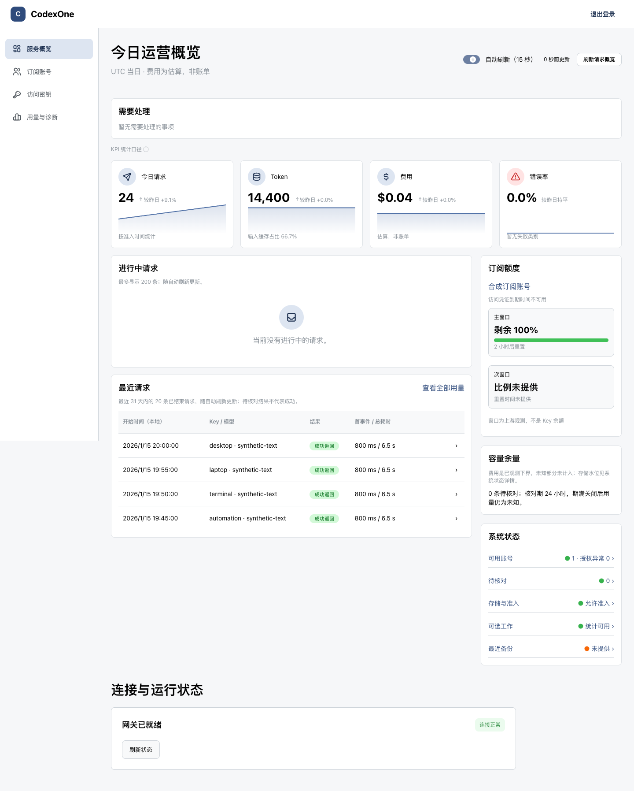
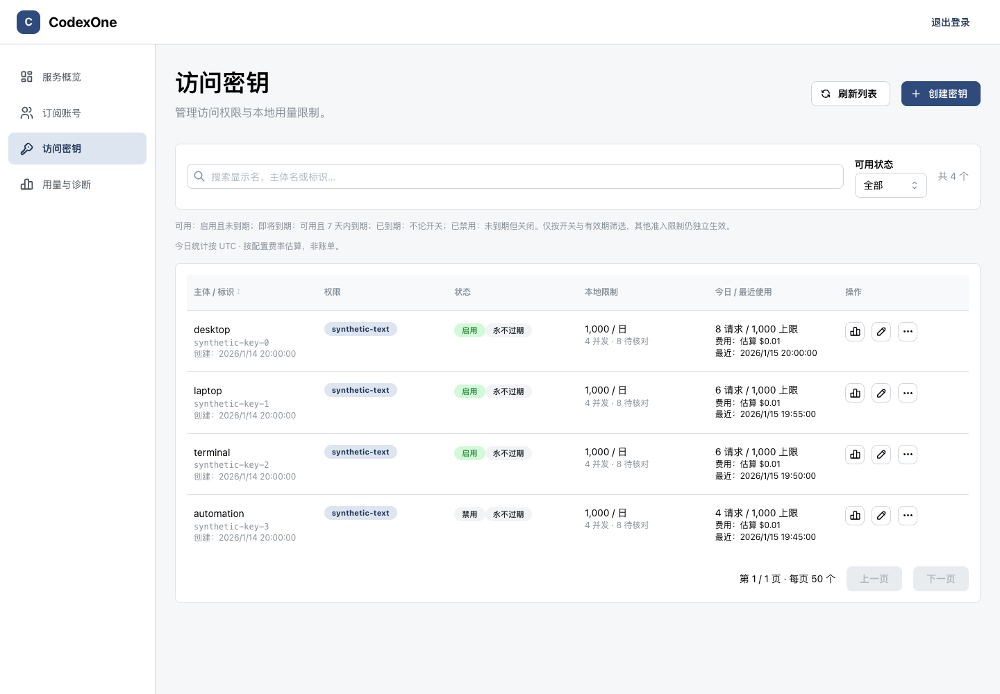

# CodexOne

A personal, self-hosted gateway for your own ChatGPT/Codex subscription accounts, with separate keys for your devices and tools, permission isolation, usage controls, and reliable forwarding.

[中文](README.md) · [Documentation](docs/README.md) · [Project status](STATUS.md)

## Why use it

- Separate keys for each device or tool, with model/image permissions, limits, rotation, and archiving.
- Browser authorization for your own accounts, encrypted credentials, automatic refresh, and quota observations.
- Per-key requests, tokens, estimated costs, and failure diagnostics; missing usage stays unknown.
- Responses HTTP/SSE, WebSocket, warmup, compaction, tools, image generation, and reference-image edits. Possibly executed requests are not automatically replayed.
- Independent master keys, snapshot backups, explicit migrations, and controlled recovery.

## Screenshots

All accounts, models, and requests below are synthetic.





## Quick start

**v0.26.1 has not been released.** GHCR images will be available after the first release. Until then, [build from source](docs/guide/linux-installation.md). The runtime target is Linux amd64 Docker Engine with Compose v2, Python 3, reliable local storage, and a host HTTPS reverse proxy.

From the source checkout:

```sh
docker pull ghcr.io/aruis/codexone:0.26.1
CODEXONE_IMAGE_ID="$(docker image inspect ghcr.io/aruis/codexone:0.26.1 --format '{{.Id}}')"
python3 deploy/init-install.py ../codexone-private \
  --image "$CODEXONE_IMAGE_ID" --origin https://admin.example.invalid
cd ../codexone-private
# Privately edit secrets/pool.json: available models, capabilities, estimated rates
python3 compose-install.py run --rm gateway --check-config
python3 compose-install.py up -d
```

Configure [HTTPS data and admin endpoints](docs/operations/tls-proxy.md). Sign in as `admin` using the private `secrets/admin` file. [Authorize and enable your account, then create a device key](docs/guide/admin.md). Never publish secrets or OAuth callbacks. Readiness is 503 without an enabled account.

Set the key in `CODEXONE_API_KEY`, then configure Codex:

```toml
model = "<configured-and-authorized-model>"
model_provider = "codexone"

[model_providers.codexone]
name = "openai"
base_url = "https://gateway.example.invalid/backend-api/codex"
wire_api = "responses"
supports_websockets = true
env_key = "CODEXONE_API_KEY"
requires_openai_auth = false
http_headers = { "x-openai-actor-authorization" = "codexone" }
```

The provider name and header are compatibility settings, not official authorization. Restart Desktop and start a new session. See [client setup](docs/guide/client-setup.md).

## Requirements and limits

Linux amd64 containers use host networking, loopback listeners, and local named volumes behind a host TLS proxy; the template does not directly support Docker Desktop. Its 768 MiB memory limit is not a minimum host requirement or throughput guarantee. Source development uses macOS 15+, Swift 6.4, Node.js 22.23.0, and Python 3; Linux builds require SQLite development headers.

Single node and administrator only. Full multi-account routing validation remains pending. No billing service, multi-admin RBAC, or high availability. Costs are estimates, quotas are observations, and token/cost limits are not absolute caps. Client-facing body/image recovery caching is not implemented; output recovery after disconnection or restart is not guaranteed. See [compatibility](docs/reference/compatibility.md).

## Documentation

[Installation and configuration](docs/guide/README.md) · [Admin panel](docs/guide/admin.md) · [Backup and upgrades](docs/guide/backup-upgrade.md) · [Migration from codex-lb](docs/guide/migration.md) · [FAQ](docs/guide/faq.md) · [Operations](docs/operations/README.md) · [API and specs](docs/reference/README.md) · [Architecture](docs/architecture/ARCHITECTURE.md) · [Contributing](CONTRIBUTING.md) · [Security](SECURITY.md)

Detailed guides are currently in Chinese.

## Disclaimer and risks

CodexOne is an independent, unofficial project, with no affiliation with or endorsement by OpenAI. OpenAI, ChatGPT, and Codex are trademarks of their respective owners.

The gateway accesses upstream services using **official Codex client identifiers and the official OAuth client ID**. This may violate provider terms, trigger risk controls, or restrict your account. Internal endpoints and protocols may change at any time. You must verify the applicable terms, authorization, and account risks yourself. Technical compatibility and the MIT license do not grant access rights to provider services. This project is for your own accounts and devices; it does not grant permission to share subscriptions with others.

## License

[MIT](LICENSE). [Provenance](docs/reference/provenance.md) · [Third-party notices](THIRD_PARTY_NOTICES.md).
