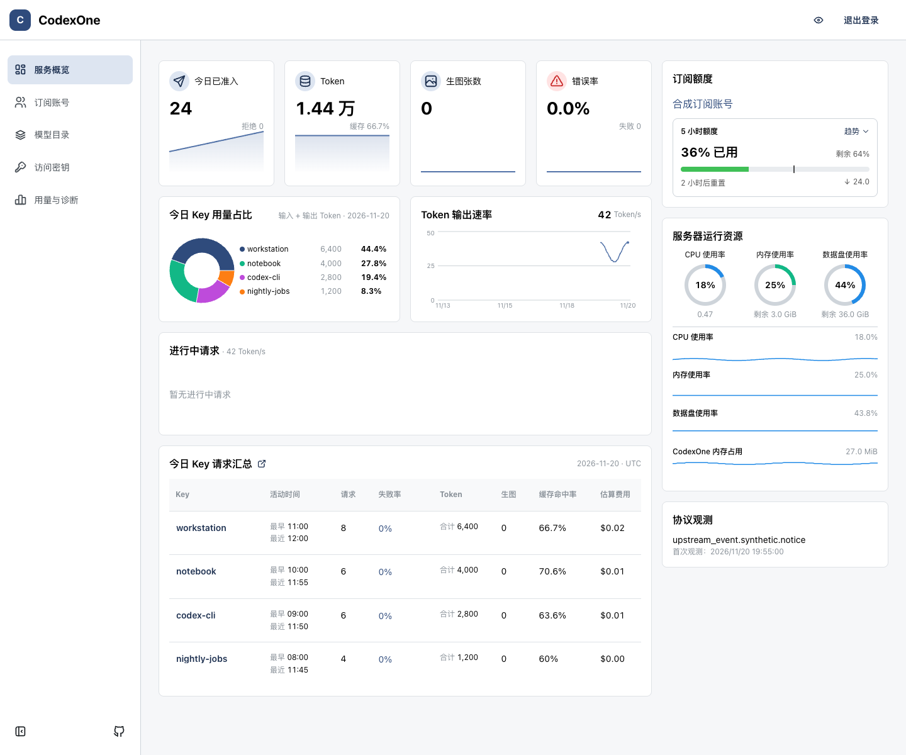
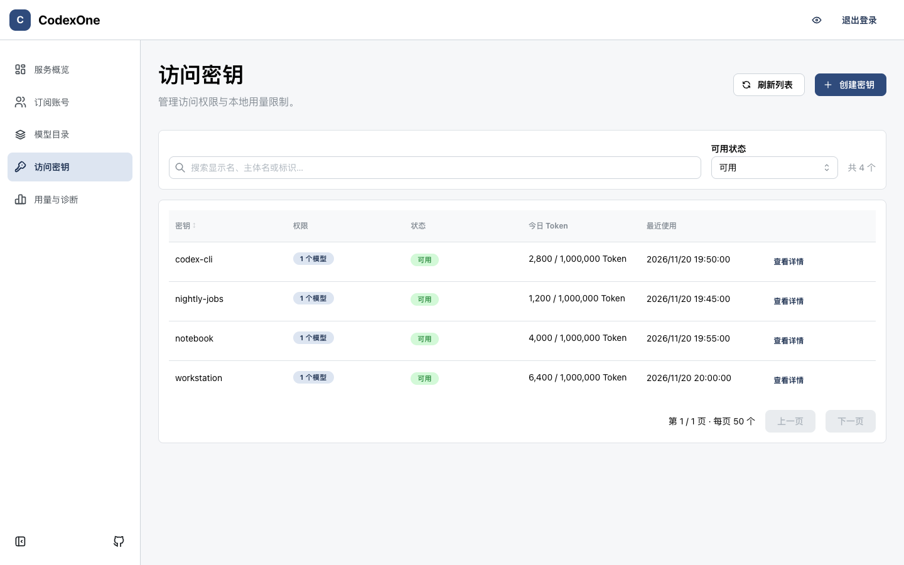

# CodexOne

CodexOne is a personal, self-hosted gateway written in Rust. Connect your own ChatGPT/Codex subscription accounts, then issue a separate access key to each workstation, laptop, or tool. Each client uses the gateway address and its own key. When you retire a device, you can revoke its access individually.

[中文](README.md) · [Latest release](https://github.com/ximatai/codexone/releases/latest) · [Documentation (Chinese)](docs/README.md)

## What you can do

- **Manage accounts and devices.** Authorize your accounts in the admin console, monitor subscription quotas, and choose which models, vision inputs, and image tools each key can use. Set a concurrency limit per key.
- **Connect Codex CLI and Desktop.** The gateway supports Responses over HTTP/SSE and WebSocket, including tool calls, image generation, and reference-image edits. If the provider may already have executed a request, the gateway will not replay it automatically. [Client compatibility](docs/reference/compatibility.md)
- **Track usage.** See requests, successes, failures, tokens, and estimated costs by device. Estimates use the model rates you configure. Missing usage is marked as unknown.

## Admin console

These screenshots show the current console with synthetic data. The overview shows which devices used the gateway today and when the subscription quota resets.



On the Access Keys page, you can review permissions, rotate a key, or disable one device.



## Install

The release image runs on **Linux amd64**. The server needs Docker Engine, Compose v2, Python 3, and local disk storage. Use the source archive and image from the same release. The archive contains the installer and the image contains the compiled gateway. The example below uses v1.26.58.

```sh
VERSION=1.26.58
RELEASE="https://github.com/ximatai/codexone/releases/download/v$VERSION"
curl -fLO "$RELEASE/codexone-$VERSION-source.tar.gz"
curl -fLO "$RELEASE/SHA256SUMS"
sha256sum --check --ignore-missing SHA256SUMS
```

Once the checksum check prints `OK` for the source archive, unpack it and get the local image ID.

```sh
tar -xzf "codexone-$VERSION-source.tar.gz"
cd "codexone-$VERSION"
IMAGE="ghcr.io/ximatai/codexone:$VERSION"
docker pull "$IMAGE"
IMAGE_ID="$(docker image inspect "$IMAGE" --format '{{.Id}}')"
```

Choose one setup below. The installer creates a new `codexone-private` directory outside the source tree for configuration and secrets. If you run the installer as root, add `--uid 10001 --gid 10001` to the command.

### LAN deployment (no domain)

Replace the example IP with the server’s fixed private address. HTTP sends credentials, keys, and request contents in plaintext. Use this mode only on a private network you trust, and keep both ports off the public internet.

```sh
python3 deploy/init-install.py ../codexone-private --image "$IMAGE_ID" --lan 192.168.1.10
```

### Deploy on your own server (HTTPS)

Set `--origin` to the exact HTTPS address you will open in your browser. The gateway listens on loopback by default. Configure your TLS proxy to route client traffic to port 18080 and admin traffic to port 18081. You can expose just the client endpoint and keep the admin console private. [TLS proxy guide and Nginx templates](docs/operations/tls-proxy.md)

```sh
python3 deploy/init-install.py ../codexone-private --image "$IMAGE_ID" --origin https://admin.example.com
```

### Start the gateway and send your first request

1. Change to `../codexone-private` and edit `secrets/pool.json`. Replace the model placeholder with a model available to your subscription. Enter its rates if you want cost estimates. [Gateway configuration](docs/guide/configuration.md)
2. From the installation directory, check the configuration and start the service.

   ```sh
   python3 compose-install.py run --rm gateway --check-config
   python3 compose-install.py up -d
   ```

3. Open the admin address printed by the installer. Sign in as `admin` using the secret in `secrets/admin`. Add, authorize, and enable your subscription account. Open Access Keys (访问密钥) and create a device key. Save the full key when it appears, as it is shown only once.
4. On the client, store the key in `CODEXONE_API_KEY`. Set the gateway’s **client** URL and a model allowed for this key in `~/.codex/config.toml` using the linked example. Start a new session, send a message, and look for the request under that key in the console. [Codex CLI and Desktop configuration](docs/guide/client-setup.md)

Before upgrading an existing installation, back up the data and master key and keep the previous image reference. [Upgrade and rollback](docs/guide/backup-upgrade.md) · [Installation and source builds](docs/guide/linux-installation.md) · [FAQ](docs/guide/faq.md)

## Scope

CodexOne is designed for one administrator managing their own accounts and devices on a single node. It is an independent project with no affiliation with OpenAI. The gateway uses Codex client identifiers and the OAuth client ID to access upstream services. Provider protocols and terms can change. Check the authorization and terms that apply to your account. [Compatibility and account risks](docs/reference/compatibility.md)

[Project status](STATUS.md) · [Admin guide](docs/guide/admin.md) · [Contributing](CONTRIBUTING.md) · [Security reports](SECURITY.md) · [MIT license](LICENSE) · [Third-party notices](THIRD_PARTY_NOTICES.md)
