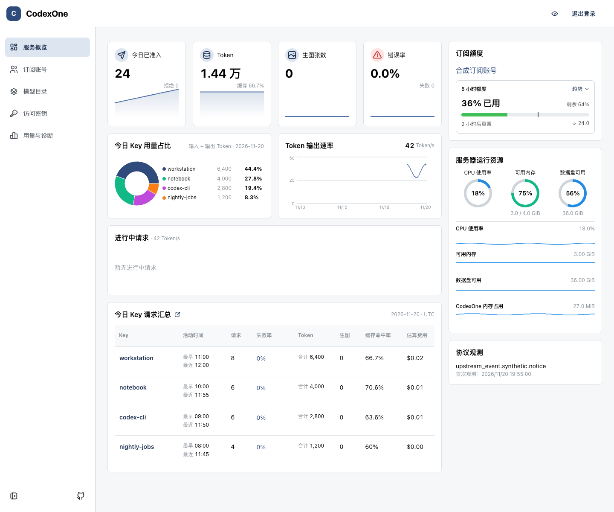
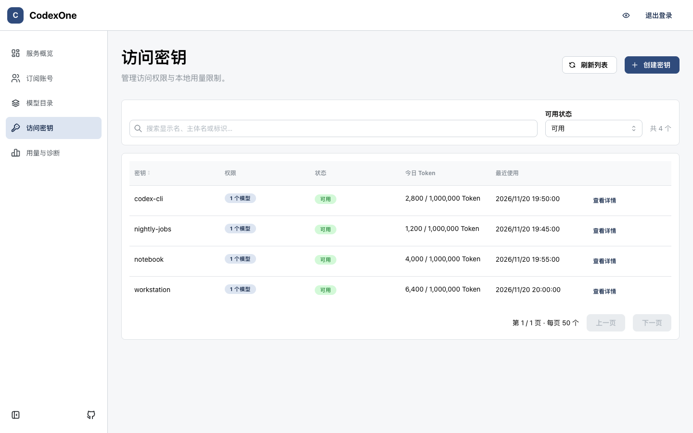

# CodexOne

CodexOne 是用 Rust 编写的个人自托管网关。把自己的 ChatGPT/Codex 订阅账号接入网关，再给工作站、笔记本或自动化工具各发一枚 Key。设备上只需配置网关地址和自己的 Key；更换设备时，可以单独撤销那枚 Key。

[English](README.en.md) · [最新正式版](https://github.com/ximatai/codexone/releases/latest) · [文档](docs/README.md)

## 可以用它做什么

- **管理账号和设备。** 在管理台授权自己的订阅账号、查看剩余额度，为每枚 Key 配置可用模型、视觉输入、图片生成和并发上限。
- **接入 Codex CLI 和 Desktop。** 网关支持 Responses HTTP/SSE 和 WebSocket，能转发工具调用、图片生成和参考图编辑。上游可能已执行的请求不会自动重放。[客户端兼容范围](docs/reference/compatibility.md)
- **看清用量。** 按设备查看请求数、成功与失败、token 用量和估算费用。费用按本地配置的模型费率计算；缺失用量会标记为未知。

## 管理界面

以下截图由当前管理台使用合成数据渲染。首页能看到今天哪些设备在使用网关，以及订阅额度何时重置。



在访问密钥页可以逐个查看设备权限、轮换 Key，也可以单独停用某台设备。



## 安装

正式镜像面向 **Linux amd64**。服务器需要 Docker Engine、Compose v2、Python 3 和本地磁盘。使用发布页中同一版本的源码包和镜像，源码包提供安装脚本，无需编译 Rust。以下以正式版 v1.26.55 为例。

```sh
VERSION=1.26.55
RELEASE="https://github.com/ximatai/codexone/releases/download/v$VERSION"
curl -fLO "$RELEASE/codexone-$VERSION-source.tar.gz"
curl -fLO "$RELEASE/SHA256SUMS"
sha256sum --check --ignore-missing SHA256SUMS
```

确认对应源码包显示 `OK` 后，解包并取得本机镜像 ID。

```sh
tar -xzf "codexone-$VERSION-source.tar.gz"
cd "codexone-$VERSION"
IMAGE="ghcr.io/ximatai/codexone:$VERSION"
docker pull "$IMAGE"
IMAGE_ID="$(docker image inspect "$IMAGE" --format '{{.Id}}')"
```

选择下面一种方式初始化。安装器会在源码目录外新建 `codexone-private`，保存私有配置和密钥。以 root 运行安装器时，追加 `--uid 10001 --gid 10001`。

### 局域网部署（无域名）

将示例地址换成服务器的固定私有 IP。HTTP 会明文传输登录凭证、Key 和请求内容，只适用于你信任的私有网络。请勿通过端口转发将这两个端口暴露到公网。

```sh
python3 deploy/init-install.py ../codexone-private --image "$IMAGE_ID" --lan 192.168.1.10
```

### 部署到自己的服务器（HTTPS）

将 `--origin` 换成浏览器实际访问的管理地址。这个模式下网关默认监听回环地址。按反代指南配置 TLS，分别转发数据入口（18080）和管理入口（18081）；需要对外提供服务时，也可以只公开数据入口。[TLS 反代与 Nginx 模板](docs/operations/tls-proxy.md)

```sh
python3 deploy/init-install.py ../codexone-private --image "$IMAGE_ID" --origin https://admin.example.com
```

### 启动并发出第一条请求

1. 进入 `../codexone-private`，编辑 `secrets/pool.json`，把模型占位符换成订阅可用的模型名。需要估算费用时，填写对应费率。[网关配置](docs/guide/configuration.md)
2. 在安装目录检查配置并启动服务。

   ```sh
   python3 compose-install.py run --rm gateway --check-config
   python3 compose-install.py up -d
   ```

3. 在安装器给出的管理地址用 `admin` 和 `secrets/admin` 中的秘密登录。添加并授权订阅账号，启用后在「访问密钥」页创建设备 Key。完整 Key 只显示一次。
4. 在客户端将 Key 保存到 `CODEXONE_API_KEY`，按接入示例配置网关的数据地址和该 Key 可用的模型。新建会话发送一条消息，然后在管理台查看这枚 Key 的请求记录。[Codex CLI 与 Desktop 配置示例](docs/guide/client-setup.md)

已有部署请先备份数据和主密钥，并保留旧镜像引用。[升级与回退](docs/guide/backup-upgrade.md) · [安装详解与源码构建](docs/guide/linux-installation.md) · [常见问题](docs/guide/faq.md)

## 使用范围

CodexOne 面向单节点、单管理员管理自己的账号和设备。它是独立项目，与 OpenAI 无隶属关系。网关通过 Codex 客户端标识和 OAuth 客户端 ID 访问上游；提供者协议和条款可能变化，使用前请确认账号授权与适用条款。[兼容性与账号风险](docs/reference/compatibility.md)

[项目状态](STATUS.md) · [管理台指南](docs/guide/admin.md) · [贡献指南](CONTRIBUTING.md) · [安全报告](SECURITY.md) · [MIT 许可证](LICENSE) · [第三方许可](THIRD_PARTY_NOTICES.md)
