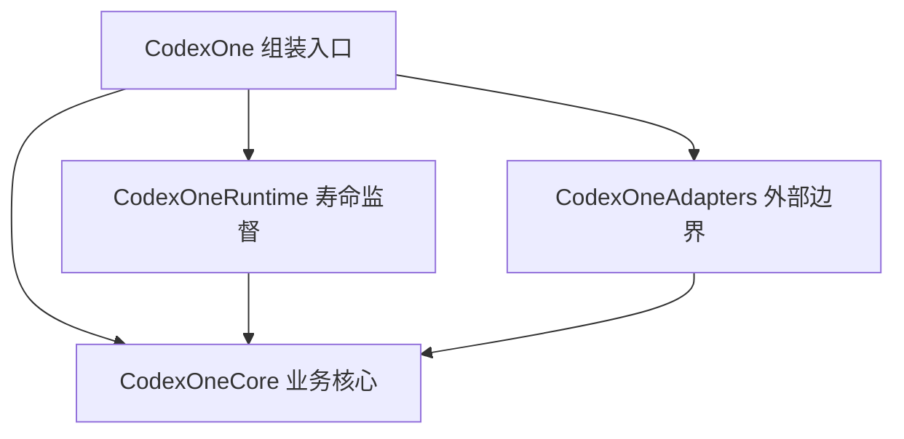

# CodexOne 架构

本文件描述结构与取舍，不记录实现进度。产品边界见 [产品目标](../requirements/product.md)，行为契约以 [规范](../reference/specs/README.md) 为唯一来源；共识可凭新证据按 [治理](../governance.md) 调整。验证结果与下一步只见 [STATUS](../../STATUS.md)。

## 定位与技术方向

自托管的 Codex/Responses 网关，以身份隔离、协议连续性、可解释治理与故障恢复为重点。采用 Swift 模块化单体：NIO 数据面、Vapor 管理面、AHC 上游，SQLite 单节点；管理台 TS/React/Vite 静态 SPA，Linux amd64 OCI/Compose。理由见 [共识决策](decisions/README.md)，兼容边界见 [协议兼容](../reference/compatibility.md)。

原型的 Linux CI 和 macOS 真实 CLI 结果只属于原型，不能推导本项目通过。正式产品以 Desktop 为主要兼容验收对象，CLI 是补充外部测试客户端，服务器直接调用上游。原型特殊配置与双入口限制不作为生产默认。

## 模块与依赖

四个名称表达起始编译边界，具体 targets 在包功能中验证，不以空目录决定额外库。Core 内 Domain 表达状态与规则，Application 协调授权/准入/绑定/结算。Adapters 内分客户端协议、传输、上游 wire、持久化和管理 API；Runtime 管理有限任务、启动和关闭。入口注入具体实现，避免 Runtime/Adapters 互相 import。

[目录约定](../development/layout.md) 定义文件归属；[owner 与端口](ownership.md) 定义谁调用谁、持有什么状态，以及结束责任。网络 channel、SQL row、Vapor Request 不进入核心签名；不预建通用 AI schema 或插件 DSL。

## 请求与数据流

客户端解析/能力校验 → Core 应用命令 → 原子持久准入 → 提供者适配 → 语义证据 → 归属提交后输出 → 最终化/迟到证据。

客户端 wire 和提供者 wire 分开演进：客户端扩展字段留在有界协议层，上游适配器提供对象/usage/终态/拒绝证据，Core 决定授权与结算。透明数据仍需能力分类，不能以透传绕过未知对象/控制语义。

执行/WS 状态机、ID 暴露屏障和最终化的完整条款见 [execution-lifecycle](../reference/specs/execution-lifecycle.md)；身份/刷新见 [identity](../reference/specs/identity.md)，重试/模式见 [protocol](../reference/specs/protocol.md)。本文件不复制第二份状态转移规则。

## 持久化、治理与恢复

核心库保存身份、策略、准入、归属和账本；恢复库保存可降级的加密正文。二者不做伪跨库事务，核心结算优先于缓存负载；资源隔离设计见 ownership。SQLite 的单节点限制、备份/旧快照恢复与保留条款见 [operations](../reference/specs/operations.md)。

用量方案以可用性与订阅账号保护为先：预留与实际证据分开，未知记账和全局参考阈值不阻断，显式 Key 限额、账号并发和存储安全保留阻断；不宣称绝对 token/金额上限，完整算法见 [usage](../reference/specs/usage.md)。

短期恢复缓存的动机见 [共识决策](decisions/README.md)，存储安全见 [recovery-cache](../reference/specs/recovery-cache.md)。恢复的具体客户端关联、读取与失败契约须先验证可用，不预设私有请求头或新增公共入口。缓存本身不等于客户端自动续传能力；断点续播与透明重执行不隐含在缓存目标中。

## 管理与发行

管理台按账号、Key/策略、用量/请求、恢复/运维能力聚合。最小管理 API 先明确错误、ID、日期、单位、继承和 secret write-only 契约，前端不复制后端领域模型。管理同源/代理与认证边界在首个管理入口验证；见 [control-plane](../reference/specs/control-plane.md)。

镜像由 CI 构建，弱服务器只运行；安全维护、恢复演练和容量证据属于发行验收，见 operations。路线是 [项目里程碑](../../STATUS.md)，执行顺序可随依赖和实验调整。

## 演进触发

第二个真实上游、实际编译/依赖污染、SQLite 写等待、多节点需求或新的恢复契约，都可触发新方案；先给证据与代价，再调整共识决策和受影响规范。不要为假设扩展预建服务，也不要把原方案当作不能讨论的限制。

## 相关文档

[文档导航](../README.md)
