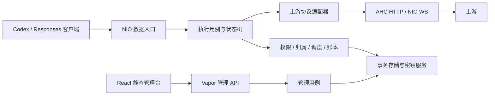

# CodexOne 产品架构（实施基线）

日期：2026-10-21。状态：产品边界已确认的实施基线；参数默认值待实现验收，不代表代码已完成。工程屏障、资源约束和隔离规则应直接进入实施规范，无需再让用户审批正确性。原始独立设计 [PROPOSED-ARCHITECTURE.md](PROPOSED-ARCHITECTURE.md) 保持 349 行不变；本稿吸收 [独立审查](ARCHITECTURE-REVIEW.md)，作为后续讨论入口。

## 1. 产品定位、证据和边界

CodexOne 是开源、自托管的 Responses 客户端账号池与 API 网关。价值在于稳定接入、身份与对象隔离、长连接连续性、可解释调度、可追溯限额及故障恢复。首版应交付完整路径：安全初始化 → 授权受支持的上游身份 → 创建受限 Key → Codex 文本/工具/图片工作流 → 排查与结算 → 撤销 → 升级及恢复。

已知方向是 Swift 主栈、小规模自托管、资源受限服务器、CI 构建。以下本地事实由根代理提供，本稿将其作为有明确范围的工程依据，没有重新读取原型实现：

- Codex CLI 0.163.0 原生图片扩展实际调用独立 `/images/generations`，启用兼容 provider 声明后真实 PNG 已通过。因此首版包含独立 Images generation；编辑、文件服务可延期。此事实不证明所有后端、参数或图片客户端均兼容。
- 当前 Vapor 高层 HTTP 在上游静默/未返回响应头时不能及时识别下游断连，持有 channel 生命周期的 NIO 路径已通过。因此正式数据面选定**窄 NIO 单一路径**，统一 HTTP/WS/Images 入口，不再安排 Vapor 与 NIO 竞争选型。仍需正式实现的 Linux 验收。
- CLI 仅作外部兼容测试客户端；服务器直接调用上游协议，禁止按请求启动 CLI。现有许可证为 MIT、Linux amd64 CI 已有；ARM 和原生 systemd 尚未验证。

用户已确认：首发 Codex/ChatGPT 订阅账号池优先，其他上游以后适配；自托管、单管理员管理域，包含多个上游身份与隔离的 Key/principal；资源治理采用请求/并发硬限、token/图片按已知用量治理、风险披露与限制，金额估算，不首发严格 billing。工程可保证本地资源与未确认执行数量有界；没有可信成本上界的组合不能承诺 token/金额超额数值封顶，用户已确认兼容优先，允许正常续接、图片和工具流程，披露可能超额。公开 API 多 Key 适配不能替代订阅账号池验收；公开 API 文档不证明订阅后端协议、额度或授权权利。

采用单节点单进程、SQLite。用户已确认首发保留有容量上限、有期限的正文恢复缓存，包含恢复所需的请求/响应及其中图片内容；它是短期恢复设施，不是永久聊天历史库。具体边界见 §9.1。

不在首版预建：公网 SaaS、支付、跨地域 HA、多实例、托管完整历史、资产相册、通用路由 DSL、插件框架、Redis/消息中间件。禁止修改或部署已有 Ali 服务。本轮仅改文档，不访问凭证、不调用真实账号、不实现或推送。

## 2. 首版能力组合与明确拒绝

发布清单按“后端 × 客户端版本 × 端点 × 传输 × 执行模式 × 工具”列允许组合；未知组合在 dispatch 前拒绝，不靠透传假设语义相同。元数据扩展字段可保留，执行控制、工具、外部对象引用采用允许列表。适配器声明支持组合，发布夹具证明该声明。

| 能力 | 首版策略 |
|---|---|
| HTTP `POST /v1/responses` | foreground、普通 JSON/SSE；`background=true` 明确 400，不改写为 false |
| WS `/v1/responses` | `response.create`，default/named lane；同 lane FIFO、跨 lane 受控并行；整个连接同上游身份 |
| WS `generate:false` | 单独 warmup 状态机；仅在首发适配器声明并经夹具验证后开放，不作为普通生成统计 |
| 文本与客户端 function tools | 支持所选 Codex 契约；网关不执行用户函数/CLI；每次客户端提交工具结果是新 turn |
| 图片输入/Responses image tool | 分别授权、限制和计量；仅开放已验证的模型与参数组合 |
| 独立 Images generation | 首版必含 `/images/generations`，兼容配置只增加经验证路径别名，不做任意后缀转发 |
| compact | 首版客户端兼容测试若依赖则作为单独前台模式实现；输出先分类，含私有引用需绑定；无法支持的后端明确拒绝 |
| conversation、远端 MCP、内置检索/容器、文件上传/读取、图片 edits | 首版关闭，直到归属、成本及生命周期有独立契约；不是“普通工具透传” |
| 后台任务、steering、未实现的取消/控制事件 | 首版拒绝；只允许经过契约验证的 turn 级取消，否则采用连接级关闭策略 |
| GET/delete/cancel response | 不承诺公共对象服务；仅适配器拥有且不暴露给客户的核对接口可内部使用 |

保留允许的未知事件/字段时，也必须保证它们不引入未识别的可引用对象。适配器的事件策略分为：可透明数据、含归属对象需屏障、终态/usage、未支持控制。未知普通事件可透传；未知执行控制或对象创建事件终止为协议不支持，不以“透明”绕过准入。

### 统一的模型与图片授权

创建 Key 时分别配置对话模型允许范围、视觉输入能力与图片生成能力。截图/图片输入属于视觉对话；关闭图片生成不能连带禁止合法模型的视觉输入。图片生成由同一 `image_generation` 权限控制 Responses 内置生成工具与独立 Images generation，两条入口调用同一应用层能力判定和资源治理，不能各自实现不一致的开关。客户端 provider 能力声明只用于协商和兼容，不是授权依据。

模型目录按当前 principal 的策略、允许 pool、有效身份能力与模型映射求交，只列至少存在一种有效授权路由的模型，并显示生成能力所需权限；不能展示一个广泛目录再依赖上游拒绝。瞬时 cooldown 属于可用性状态，可保留模型条目但明确暂不可用；授权撤销/能力失效则立即更新目录。模型列表、实际执行、Responses 工具与 Images 映射复用同一能力解析器；模型别名不得绕过允许列表。

官方 foreground SSE、WS warmup/lane 与 background 是不同执行模型；后台请求可在断流后继续执行，故不能纳入本稿前台生命周期。[Streaming](https://developers.openai.com/api/docs/guides/streaming-responses)、[WebSocket](https://developers.openai.com/api/docs/guides/websocket-mode)、[Background](https://developers.openai.com/api/docs/guides/background)

## 3. 技术与模块

推荐模块化单体、一个服务进程、本地 SQLite、静态管理 SPA；Vapor 管理 API 可独立 loopback 监听，数据面 NIO 监听接收 HTTP/WS/Images。TLS 可由受控反向代理终结，服务器仍验证上游 TLS。生产部署不需要 Node 或 Swift 编译器。



- Domain：身份命名空间、能力组合、状态、准入与计量值类型；不依赖框架。
- Application：请求/turn 协调、管理用例、事务边界、时间与 I/O 端口。只在外部依赖边界抽象，不为每个函数建协议。
- Protocol/Upstream：有界解析、认证注入、对象/usage 提取、错误分类、能力及身份验证证据。
- Transport：NIO channel 生命周期、单 reader/writer、背压、关闭、事件提交屏障；不直接扣额选账号。
- Persistence：SQLKit/SQLite 驱动与显式 SQL 事务；CRUD 可用 Fluent，但事务不能隐藏条件更新/受影响行数。
- Runtime：实例锁、启动恢复、有限任务监督、finalizer、配置与观测；不串行处理每个 token/帧。
- ControlPlane：Vapor 管理 API 与静态 TypeScript/React/Vite UI；不绕过用例直接改热路径字典。

Swift 6 语言模式、严格并发、锁定工具链和 Package.resolved；当前目录实验要求 Swift 6.4，正式最低版本按依赖及 Linux CI 锁定。并发检查约束数据竞争，不替代 actor 重入、事务或取消正确性。[Swift](https://www.swift.org/migration/)

AHC 用长寿命进程级客户端、明确池和关闭顺序、禁用自动重定向；WS 使用 NIOWebSocket 的窄适配层。AHC body 迭代背压必须连接下游写完成，才是端到端背压。Vapor 的高层接口不再承担数据面生命周期。[AHC](https://github.com/swift-server/async-http-client)、[NIO](https://github.com/apple/swift-nio)、[Vapor](https://docs.vapor.codes/basics/async/)

SQLite 仅本机可靠磁盘、单 writer 服务；不支持共享网络盘或水平写入。未来出现持久写等待、HA 或多实例要求时迁移 PostgreSQL，迁移包含离线转换、约束与账本校验、停机切换和回滚，不承诺更换驱动即完成。[SQLite WAL](https://www.sqlite.org/wal.html)

## 4. 执行、所有权与提交屏障

核心记录是稳定 principal、API Key、Provider namespace、UpstreamIdentity、CredentialVersion、PolicyVersion、Request、Attempt、Reservation、LedgerEntry、ObjectBinding。连接、lane、网络租约与 actor mailbox 是有限运行态。所有 attempt 在 dispatch 前持久记录身份和执行意图；所有对外可引用 ID 先持久归属，再暴露。

```text
请求：validated -> admitted -> dispatch_intent -> possibly_sent
      -> terminal_observed | confirmed_rejected | indeterminate -> finalized
账本：held -> settled | released | pending_reconciliation
      pending_reconciliation -> settled | released（追加核对/调整记录）
网络：allocated -> connecting -> open -> closing -> released
暴露：none -> unresolved -> resolved（不随网络 released 自动改变）
```

状态分别记录，不能用“客户端已取消”覆盖“上游可能仍执行”。HTTP response head 已提交、语义输出已暴露、上游是否明确接受也是独立事实。没有上游幂等/查询保证时，不可能提供跨数据库与上游 exactly-once；本地只能保证幂等结算与保守识别不确定执行。

### 屏障 A：准入与 dispatch

一个短事务校验 Key/策略版本、归属、预算与未知暴露阈值，条件扣占预留并插入 request/attempt intent。提交后才可 dispatch；写 intent 前取得本地执行/暴露容量和 finalizer ticket，任何失败释放这些临时资源且不发上游。持久 attempt 的 identity/namespace 不再可变。发送可能开始后即视为 unresolved，只有明确拒绝、可信终态或经审计核对才解除。

### 屏障 B：ID 归属先于暴露

适配器标注所有允许的可引用 ID 字段。首次含 response ID/文件等可引用对象的完整事件或普通 JSON，先在有界窗口识别并校验 → 事务写入 `(principal, namespace, identity, objectType, rawID, attempt, parent?, expiresAt)` → 提交 → 发布内存索引 → 才允许下游写出包含该 ID 的字节。跨 lane 立即分叉也只能查提交后的绑定。无需每个 delta 写库。

SSE/WS 单事件先缓冲到配置上限再过屏障；普通 Responses/Images JSON 首版有总 body 上限，完整解析与绑定后提交，内存计入全局大响应预算，不写临时正文文件。大 base64 不能无限收集；超限明确失败并结算已发生用量，不能宣称无限图片流式。未来确需更大结果再独立设计增量对象屏障。

绑定写失败则停止暴露本事件，关闭执行并保留 intent/held 供恢复，绝不换账号重放；已向客户端暴露的更早绑定不删除。上游产生了 ID 但本地尚未提交时崩溃，成本可为 pending，而客户端没获得该新 ID；这正是屏障的恢复边界。任何首版无法识别的可引用对象输出应禁止该能力组合，而不是漏绑后继续服务。

### 屏障 C：最终化单次移交

每个 admitted attempt 预先获得一个 finalizer ticket；进程内 ticket 总数有界，至少覆盖所有可能在途 attempt。连接侧使用原子 `open -> handedOff` 转移一次终态快照；重复完成/取消仅合并证据，不能重复投递结算。finalizer 持独立监督域，不等待 connection actor；网络 reader/writer 关闭也不等待 DB/finalizer。顺序为停止读写与关闭 channel → 移交 ticket → await 网络子任务 → 回收网络租约。避免 writer 等 finalizer、finalizer 又等连接的循环。

handoff 之后的迟到终态/usage 走独立 `mergeEvidence(attemptID, evidenceID, revision)` 路径，不再尝试第二次移交 ticket。每 attempt 预留一个有界证据槽，来源事件用业务唯一键去重；适配器将 cumulative usage 作为更高完整度快照合并，将确需累加的 delta 按序号恰好计入一次。finalizer 未提交时纳入其下一次快照；已提交时追加唯一 adjustment，不能再结算同一 reservation。网络子任务收敛后关闭该本地证据入口，Runtime 的核对结果仍复用同一去重/调整事务；不得因 ticket 已 handedOff 丢掉已观察用量，也不得无界收集迟到事件。DB 失败仍以原 intent/held 恢复 pending，不声称未落盘 usage 已可靠保存。

finalizer mailbox 为每张 ticket 预留终态位置，不以可失败的普通入队作为持久保证；饱和时停止新准入并 drain。数据库失败时 ticket 可保留有限快照直到 deadline，之后释放进程资源并报警，**不依赖再写一次 pending 才可恢复**：已有 held/dispatch_intent 在启动扫描时一律恢复为待核对。不得因丢失 usage 把 held 自动退款。运行中数据库不可写时停止新准入。

结算事务通过 reservation 唯一键与 revision CAS 确保单次状态转换；迟到终态与管理员调整竞争时只允许一个转移，后到证据写追加 adjustment/审计且不重复扣收。账本已结算不代表日志一定送达，非关键统计允许丢弃。

## 5. WebSocket 懒绑定、lane 与取消

```text
handshake_authenticated -> unbound -> binding -> bound(identity, socketGeneration)
                                       \-> closing -> closed
bound -> draining / closing -> closed；同一连接不重新绑定另一个身份
```

握手只认证本地主体、取得连接容量租约，不选择上游账号、不占生成槽。unbound 有首消息期限和全连接待处理字节/条目上限；超时或无合法 create 关闭。第一个经过完整验证的 create 的全部对象引用、模型和工具资格决定身份；连接协调器串行执行 `unbound -> binding`，其他首批 lane 进入有界队列。准入成功并持久记录后固定身份、建立上游 WS；连接失败收敛关闭，不用另一个账号接管同一连接。

若 first create 无额度则按协议发拒绝并保持 unbound（重试仍受速率/首消息期限限制）；有额度但身份/引用冲突明确拒绝。bound 后每个 create 的全部归属必须匹配固定身份；无归属的新 lane 也只能使用该身份。HTTP→WS 与跨连接重连先查询绑定，绝不握手先连“最空闲账号”。空闲 WS 只占连接槽；上游实际连接另受每身份 socket 配额约束，与 active turn 槽分开。

每 socket 单 reader、单帧 writer；reader 按 lane 分派，禁止每 lane 启动共享上游 iterator，禁止每帧创建无界 Task。writer 串行完成帧/分片，不能交错两个消息的片段；发送完成只证明本地写入进展，不证明对端应用已接收。入口在安排 task/actor 消息前取得字节与条目预算，producer 的 stopProducing 对接 channel read 控制，关闭显式触发 continuation 的单次 resume，不靠 deinit。[NIO producer 契约](https://github.com/apple/swift-nio/blob/main/Sources/NIOCore/AsyncSequences/NIOAsyncSequenceProducer.swift)

同 lane command FIFO：接收时做静态能力与大小检查，轮到队首时重查授权并原子准入。队列中的请求不提前占生成额度。若同 lane 前一响应活动中，本地拒绝描述也按 FIFO 排在其终态后输出，避免只有 stream_id 时把错误误归前一 turn。没有容量保存这个拒绝，或未知 lane/畸形控制无法可靠关联时，关闭整个连接，全部活动 turn 独立最终化。跨 lane 可交错，但有全局/Key/身份活动数与单连接总预算。

一个 socket 只有一条读流，不能承诺 lane 网络隔离。高水位暂停整条读取；这会延迟其他 lane 及控制帧，故设置短的总拥塞/下游写 deadline，达到硬上限或期限即关闭整连接，记录 client_too_slow/connection_congested，不惩罚上游账号。控制帧处理只在仍允许读取时前进，不能声称暂停读取后仍有独立 ping 通道。共享拥塞导致未观察终态的 lane 各自进入 unresolved。

warmup 单列：校验全部权限和归属，计入请求速率、每主体 warmup 速率与连接状态数量上限，持有短暂控制槽；无普通生成 token 预留。dispatch 前仍有 durable intent/exposure ticket，观察到适配器定义的 warmup 成功终态后按屏障 B 绑定、释放控制槽。无 usage 只有适配器明确保证“不生成/不计生成用量”的模式才可零生成结算；否则保留未知 usage，而不假设免费。warmup 后 create 走正常准入；warmup ID 缓存失效返回状态丢失，不重造历史。

取消由 connection/turn supervisor 拥有：channel inactive、deadline、显式取消都汇入一次 close transition；关闭 channel 中断 socket I/O，task cancellation 中断等待预算/刷新，continuation registry 保证一次 resume。不支持经过验证的 turn 级取消时，关闭整个上游 socket 并明确影响全部活动 lane；本地网络槽释放不证明上游已停止。服务器不生成虚假的 completed。

## 6. 身份、凭证与会话归属

Provider namespace 包含规范化可信 origin、协议种类、提供者稳定账号、组织/项目等隔离维度；UpstreamIdentity 是不可原地改义的身份。凭证导入/刷新必须通过该适配器可验证的身份声明或身份接口比对命名空间；无法验证等价性时新建 identity、排空旧 identity。不得通过改 origin/project/凭证把 U1 指向 U2 后继续使用旧绑定。管理员对语义变更只能执行“新建并替换”，不是普通编辑；删除用 tombstone 保留账本/绑定历史。

每身份单飞刷新由 Runtime supervisor 拥有，等待者取消不取消共享刷新。刷新采用 credential version CAS，写新密文提交与 refresh_intent 完成标记在同一事务后才发布内存版本。涉及旋转 refresh token 时先写 refresh_intent；若成功响应后的密文提交失败或进程中断，identity 进入 auth_uncertain，停止新 dispatch，不循环重用旧 token。重启必须扫描未完成 refresh_intent，在加载可路由快照之前重建 auth_uncertain，不能因旧密文尚在就自动 ready；除非适配器有经过验证的安全恢复机制，否则需重新授权。单飞与 CAS 不足以恢复丢失的新令牌。

账号状态正交表示 enabled/draining/disabled、ready/refreshing/requires_auth/auth_uncertain、能力、健康与模型 cooldown。先按权限、对象归属、能力、暴露阈值过滤，再用最少在途加稳定打散排序；取得原子执行租约。客户端断连、本地过载/限额不扣账号健康；认证、限流、上游故障分别分类。不能安全重放的失败不进入账号循环。

对象查询为 `(principal, objectType, rawID)` 返回候选命名空间集合；只有一个可用归属才继续。多个候选且与连接/可信上下文约束求交后仍不唯一则 binding_ambiguous；零个为 unknown_or_expired_object，fail-closed，禁止向账号池试探。原始 ID 不全局唯一，首版不改写协议 ID；Key 轮换依赖稳定 principal 保持续接，不默认跨 principal 共享。

首发保留 §9.1 的短期加密恢复缓存；归属映射本身不能重建上游上下文。缓存缺失、过期、不完整或上游状态丢失时，不能承诺无损续接，必要时由客户端用完整输入/压缩窗口主动新建。不得更改 store 或自动跨账号携带私有对象。[WS 恢复语义](https://developers.openai.com/api/docs/guides/websocket-mode#reconnect-and-recover)

## 7. 限额算法与未知执行断路

将硬请求/并发限制、token/图片治理与金额估算分别命名并在 UI 显示；严格 token 模式仅为未来边界说明，不实现首版入口。不能将“余额被正确扣减”误称“上游用量绝不超限”。整数单位和版本化费率，输出/推理/缓存/图片/工具分维度记账。窗口按 UTC 准入时间归属，结算仍归原窗口；在途沿用准入策略和计价版本，Key 撤销仍阻止新 turn。

### 用户已确认：请求硬限 + token/图片治理

每主体/窗口分别维护 `known_usage`、`estimated_usage`、`unresolved_usage`；计量完整度为 complete/partial/unavailable，未知不补零，估算不写进实际列。对选定本地治理单位维护已知已入账 `used`、`held` 和预算 `B`，每能力组合配置运营预留 `R`、可选真实上界证据 `U?`、最大在途 `C` 与未知暴露上限。准入事务要求 `used + held + R <= B`，再加 held；结算追加可信 usage，释放或核对对应预留。usage 超 R 时如实入账，可使 used 超 B，以 overage 单列、可用额度钳制为零并停止新准入；不能让余额下溢或丢弃用量。部分 usage 仅入账已知部分，剩余预留按核对政策保留，不能把部分结果当作全部结清。

| 组合 | 预留与风险策略 |
|---|---|
| 自包含文本、客户端 function tools，无隐含历史/文件/远端工具 | 有已锁模型和请求长度/输出上限时计算 U；治理预留 R 可小于 U |
| previous_response_id/压缩或隐含历史/图片输入 | 不以“上一轮 usage + 新输入”充当上界；治理模式按运营 R 准入，只有适配器声明整窗+输出保守 U 才能给出 token 超额上限 |
| Responses 图片工具/独立 generation | n、尺寸、质量、输出及工具次数均受能力表限制；以图片/credit 独立预留，token 不可得时标 unavailable，不混成零 |
| 缺失输出上限/动态模型别名 | 优先取得可信保守上界或公开的本地输出策略；缺少 U 不单独禁用治理能力；别名的协议/权限能力变化需重新验证，计量证据变化更新风险标记 |
| 无完整 usage 或无已知 U 的后端组合 | 可作为兼容治理候选，前提是身份、协议、安全与资源生命周期验证通过；token 显示 partial/unavailable，可按明确命名的请求/图片/本地 credit 治理，不将其冒充真实 token/费用 |

U 是可选证据，不是资源治理的通用启用门槛。无 U 的组合仍执行硬请求/并发/队列/图片并发限制、运营预留和未知执行断路，但 UI 必须显示“成本上界未知”，不得声称 token/金额数值封顶；固定业务 credit 只保证本地业务单位规则。若全部未决执行都有同单位可信 U，且 used 只含已结算实际值，可展示窗口潜在超额界 `max(0, used + sum(U_unsettled) - B)`；若某未决项已有部分入账，只加其尚未入账的剩余上界。混有无 U 或不完整计量项时不展示总体数值界。不能使用 `sum(max(U-R,0)) + 当前overage`，因为已结算超额可能侵占其他预留空间。订阅后端的 U/usage 需其自身证据，不能借用公开 API 参数。

用户已确认兼容优先：无 U 但协议与生命周期合格的组合可纳入兼容治理，不以计费证明阻塞正常订阅工作流；产品明确披露可能超额，管理员通过预留、阈值断路及审计核对治理未知消耗。若能力无法确定身份归属、控制重复执行风险或观察生命周期，则仍因相应工程缺陷禁用，与缺少成本 U 分开判断。

严格 token/billing 模式不进入首版。未来若引入，需固定模型能力版本、完整保守 U、有限工具次数/图片展开上界、显式或规范化输出上限，并按 U 全额预留；不是把治理模式改个名称。首版实测 usage 超过 U 同样是 capability_violation：如实记账、隔离该 profile 并停止新准入，不靠中途断流撤销已发生用量；外部上游违约不能包装成数学保证。

### 三种容量与未知暴露

分别限制 transport lease（本地连接/任务）、active turn（已确认本地活动执行）、unsettled exposure（上游可能仍执行及未知成本）。dispatch 前原子取得 exposure 容量，可信终态/明确未执行/核对完成才释放。网络关闭只释放 transport lease，active turn 收敛后 unresolved exposure 仍占容量；这防止反复断线不断生成。

配置每 principal、identity、全局的未知数量上限、held 总量上限和最老 pending 告警；达到任何阈值停止对应范围新执行，未达阈值也必须把未知暴露计入总执行风险容量。没有查询能力的适配器不启用伪“自动核对”循环；只能等迟到证据或管理员审计处理。管理员释放/计收需 reason、operator、业务唯一键与 CAS；不能简单 TTL 退款。阈值取值和未知成本承担是业务政策，工程上阈值、计数与 fail-closed 必须存在。

重启时先按 durable attempt/reservation 恢复每 principal、identity、全局的 pending/unresolved exposure 占用与 held，再开放准入；不能只恢复金额而将未知执行计数归零。网络槽和 active turn 不虚构为仍活跃，未知风险独立占 exposure。若恢复占用已达阈值，服务可 ready 提供管理诊断，但相应范围继续断路，直到可信证据或审计核对释放。

## 8. 重试、超时与错误

默认无输出也不等于可重试。未发送请求可有限重选；适配器明确证明未执行的拒绝可按总 deadline/attempt 预算重试；已发送后断线/超时、已返回 ID 或语义输出一律不透明重放。跨账号还需全部引用无归属冲突且主体允许。旧凭证 401 只有明确拒绝未执行时，单飞刷新后最多重试一次；429 尊重 Retry-After，固定谱系不跨账号。一次重试有独立 attempt 和上游成本记录。

排队、连接/TLS、响应头、首语义事件、活跃进展、下游写、总 turn 和连接寿命分别限时。NIO channel close 即使上游静默也必须触发下游取消；图片/思考可有较长 idle 策略，但不延长慢消费者期限。单调时钟用于 deadline，UTC 用于账期。

网关错误保持协议 envelope、稳定 code、脱敏信息与 request ID；区分权限、quota、capacity、unknown/ambiguous binding、上游状态丢失、授权需要更新、client_too_slow、execution_indeterminate。HTTP 提交前可回 4xx/429/502/503/504；提交后仅协议错误事件或异常关闭。WS 握手后不可返回 HTTP 状态响应；lane 错误服从第 5 节 FIFO。失败不伪装成功、EOF 不视为终态。

## 9. SQLite 持久性、恢复与保留

首版显式设置 WAL + `synchronous=FULL`；所有连接初始化并读回验证 `foreign_keys=ON`、synchronous、busy_timeout，数据库初始化验证 WAL。使用有限繁忙重试与专用有限 DB 线程池；不在 NIO event loop 执行阻塞 I/O，不跨流式持有事务。FULL 的持久性以磁盘/文件系统正确执行同步为前提，不承诺抵御失信硬件。[synchronous](https://www.sqlite.org/pragma.html#pragma_synchronous)、[foreign keys](https://www.sqlite.org/foreignkeys.html#fk_enable)

启动扫描所有旧 boot 的 held/dispatch_intent/unfinalized：确定未 dispatch 的可释放，其余默认 pending，重建其 exposure 占用；同时处理未完成 refresh_intent 为 auth_uncertain，完成后才发布路由快照。不能因 pending 标记未写成功而丢掉。正常进程崩溃恢复与主机掉电/存储故障分开验收；kill -9 仅证明前者。FULL 不允许作为未测掉电恢复的证据。

实例锁由服务、migration、restore 和密钥维护命令共同使用；离线迁移无法取得锁立即非零退出，不能旁路在线服务。命令先校验二进制与 schema 兼容范围，备份成功后迁移；失败回滚事务或保留 maintenance 状态、输出明确修复指引，数据面不得 ready。服务只做兼容检查，不自动执行破坏性迁移。

恢复旧快照总进入 `maintenance -> restored_unreconciled -> ready`：恢复工具记录快照时间、来源和恢复时刻，展示缺失区间；扫描快照内活动项，且明确快照之后的已执行项可能完全缺失。管理员选择并审计恢复后的额度基线（默认冻结受影响窗口/重发新窗口额度，不自动复活旧余额）后才启用准入。在线数据库完整性正确不代表快照缺口已核对。

建议初始保留 profile（可运营调整，需公开）：binding/歧义与过期 tombstone 保留至承诺续接窗口结束；已完成 request/attempt 诊断 30 天、审计 90 天；账本与未结项不做普通 TTL，按显式归档/导出政策压缩。首发续接窗口按所选后端契约公布，不能仅套用公开 API 天数；本地过期即 fail-closed，并告知“上游可能仍有对象、本地窗口已结束”。没有 tombstone 的完全未知 ID 同样不自由调度。

启动时为 binding 索引与待核对记录预留磁盘；低空间先暂停报表/新备份/可选聚合、清理允许过期诊断并告警，到安全阈值停止新准入，保留结算空间。监测 WAL/checkpoint、长读事务、DB busy、备份大小与空闲空间；备份不能无限占满 data volume。在线备份用 SQLite backup API 等一致性流程，不仅复制 .sqlite 而漏 WAL。[Backup API](https://www.sqlite.org/backup.html)

### 9.1 短期正文恢复缓存（用户已确认首发）

缓存只服务于断线后重放已有输出、识别重复提交及经过验证的同身份续接。按稳定 principal、namespace、identity、attempt、策略版本和输出序号隔离；Key 轮换沿用 principal，其他 principal 不得读取。恢复时重新检查当前 Key 权限与对象归属，撤销的权限不能借旧缓存继续使用。缓存不是面向普通 Key 的历史浏览或图片下载 API，也不开放任意跨会话搜索。

保存恢复所需的规范请求正文、已持久化的响应事件连续前缀、本地发布尝试状态/序号、完整性标记、父链与主体隔离指纹；完整标记只在连续事件前缀与可信终态均持久提交后封存，入队成功或网络发送完成不能代替持久完成；本地 socket 写完成不证明客户端已接收，跨缓存提交与网络写出的崩溃窗口只能记为 delivery_unknown（接收位置未知），不宣称原子投递；内联图片/base64 计入正文限额，不建立永久图片库。若上游只返回短期签名 URL，不主动下载资产，不保证 URL 过期后仍可恢复图片。不得缓存 Authorization、Cookie、refresh/access token 等认证材料；正文中的用户秘密仍属于敏感内容。首版使用独立 SQLite 恢复缓存库，正文与图片以认证加密保存，索引只存必要元数据；数据密钥有版本并绑定主体/身份/记录元数据，主密钥不随库保存。核心账本与归属库不保存正文副本。

建议首个部署档位：从 operation 创建起固定 TTL 24 小时（读取不续期），单 operation 请求与响应合计解码后正文最多 32 MiB，每 principal 最多 128 MiB，全实例最多 512 MiB。必须另限 operation/事件条目数、物理文件与 WAL 占用、后台写入队列字节和任务数，避免小记录与加密开销绕过容量限制；具体条目数和物理磁盘水位在配置 schema/容量验收中固定。所有缓存限额独立于网络请求/事件大小限制，两套都执行；总额同时包含在途写入预留。图片超过缓存限制仍可在网络允许范围内完成，但明确标注该 operation 不可完整恢复。

缓存写入采用受监督的有界工作队列及每 operation 顺序，不在网络 event loop 做加密/数据库阻塞工作。空间不足可淘汰已终态的最早缓存，禁止为写新内容无限增长；活动记录也有固定 TTL/大小限制，不能永久 pin。饱和、缓存库故障、写入截断或进程崩溃导致不完整时，标记 recovery_unavailable，停止该 operation 的缓存而不伪称已持久恢复。缓存降级不绕过主库 ID 暴露屏障、准入或结算；主库故障仍按原屏障停止执行。应验证缓存失败与原始执行成功、主库失败分别发生的组合。

重复提交只有在已验证的稳定 operation/客户端重试标识和主体归属匹配时才关联旧执行，正文指纹相同本身不等于重复请求；无法可靠关联时仅将恢复标为 unavailable，不把普通新 POST 当恢复而阻断；合法新请求仍按新执行准入，不凭正文相同去重。只重放缓存中已有的同一执行输出，不因此新建 attempt、重新扣收上游用量或再次调用模型。续播必须有经验证的去重/序号或客户端契约；无法确定客户端已接收位置时不得静默拼接成无损续传。持久缓存不能证明上游未执行、客户端未执行工具或当前上游连接状态仍存在。未知终态、缺段、缓存过期、工具副作用不明确时明确返回恢复不可用/执行不确定；禁止自动重新生成、自动执行工具，或把旧私有 ID 发送给其他账号。若未来用缓存重建新请求，必须另有显式客户端意图及去重/副作用契约，首版不做透明历史重放。

过期记录读取时立即拒绝，即使物理清理尚未完成；启动清理与周期清理覆盖正文、图片、索引及临时写入，管理台支持按 principal/会话删除恢复内容并显示缓存状态、容量和到期时间。删除正文不能删除账本、未结项或必要归属证据。删除、到期、关闭操作先提交主体/会话删除代际或全局缓存 epoch 屏障，取消并等待相关有界写任务收敛；每个排队/在途 writer 在缓存写入的同一事务内重查代际、启用状态和到期时间（或使用等价原子条件写），禁止检查后 await 再无条件提交，也禁止清理后的迟到写回填正文。关闭缓存后停止新写入并清理既有内容；运行内存仅保留当前执行必需缓冲，结束后清理，不额外保留历史。SQLite 删除不等于介质安全擦除，清理应覆盖 WAL/checkpoint 和空闲页回收；不承诺对 SSD 物理残留取证级擦除。

恢复缓存库默认排除于备份、导出、诊断包和崩溃转储；主库恢复必须在维护状态创建新的 core generation（不能沿用快照值），将其纳入缓存索引及加密关联元数据，取消旧 writer 并清空旧缓存；读取除校验 generation 外仍查询当前主库 principal/identity/attempt 归属。核心备份恢复后缓存为空，不能借残留独立缓存或旧备份复活快照之外、已过期或已删除正文。密钥轮换覆盖活动缓存版本，丢失旧密钥时明确缓存不可恢复；不影响主库账本完整性。低磁盘优先丢弃恢复缓存、暂停其写入，为准入/结算保留空间。此首版方案不新增缓存备份产品。

首发验收必须覆盖跨 principal 访问拒绝、Key 撤销后的恢复、完整/缺段与客户端重复接收、活动记录到期、包含大图片时的单项与聚合限额、条目数/物理磁盘/WAL 上限、慢写与队列饱和、清理/关闭与排队 writer 回填竞争、重启与密钥轮换、备份排除及主库恢复后的 generation fence，以及任何恢复路径均不重复模型/工具执行和账本扣收。24 小时/32/128/512 MiB 是初始容量参数，需在弱服务器档位压力测试后定稿；不再重开“是否首发缓存”的产品选择。

## 10. 安全、管理与观测

本地 Key 高熵、不可逆验证存储、首次显示一次；principal 与 Key 分开以支持轮换。权限覆盖端点/模型/工具/图片/pool/对象范围/大小/速率/并发。普通撤销默认停止新请求与新 WS turn，在途完成；紧急撤销关闭在途并保留结算，操作前展示影响。管理 session 独立、HttpOnly/Secure/SameSite、CSRF/Origin 校验、一次性初始化秘密；不把普通 Key 当管理员认证。

凭证使用认证加密和 key version，主密钥来自独立只读 secret；数据库、镜像、浏览器与日志不含明文。密钥轮换先加入新 active key，旧 key 保持 decrypt-only；分页再加密带 CAS/checkpoint，可中断恢复；完成后验证所有当前密文可解及备份清单所需版本。只有对应旧备份已重加密或明确销毁、恢复演练通过、无存量引用时才能删除旧 key；仅“线上轮完”不能销毁备份依赖。

上游 origin/端口/解析 IP 允许策略、TLS 验证、禁重定向、可信代理范围防 SSRF 与头伪造。自定义私网 origin 需管理员显式配置；用户图片 URL 不由网关默认抓取。请求/事件、分片累计、解压字节、multipart 总量均有硬限制；WS 压缩首版默认关闭。

普通日志、指标及审计不记录正文/图片/凭证/签名 URL；正文仅允许进入 §9.1 的加密恢复缓存，不能混入诊断日志；诊断显示阶段时间线、归属选择理由、策略与计价版本、取消与释放时间、pending 原因。管理台围绕身份、Key/策略、请求/会话、用量/待核对、备份与配置，不扩展成通用控制平台。

swift-log + swift-metrics 接导出适配器；指标不以 requestID/Key/responseID 做 label。重点观察队列字节、写等待、task/FD/RSS、取消释放、刷新、未知暴露、账本/DB 和 WAL。完整 tracing exporter 可延期，不承诺未验证 SDK 支持。关键审计/账本可靠保存，非关键统计有界采样。

## 11. 发行、升级与验收

首发受支持安装路径为已具 Linux amd64 CI 基础的 OCI/Compose；镜像非 root、只读根、独立 data/secret 挂载、发布校验和与版本化配置。CI 现存不代表本稿全部夹具已通过。ARM 待同版本构建与 socket/恢复测试通过再支持；systemd 待原生资产、发行版/运行库契约、同版本安装/恢复夹具齐全后发布，不提前宣称两条成熟路径。MIT 已存在，不重开许可证选择；补安全漏洞私密报告入口与支持版本政策。

反向代理模板覆盖 SSE 关闭缓冲、WS Upgrade、长连接期限、大小限制和可信头。live 只表示进程可调度；ready 要求持久性配置/密钥/schema/恢复准入均通过。账号耗尽是容量状态，不让 liveness 无限重启；健康检查不调用付费模型。

关闭顺序：停止准入与新 WS turn → drain 有界期限 → 关闭仍活动 channel、移交 finalizer → await 网络任务 → 有限 flush/记录未结 → 关闭 AHC/DB/event loop。超时的 WS 会断开，单节点短暂停机是明确契约。回滚区分 schema 兼容二进制回滚与快照恢复，后者必须走 maintenance/reconciliation。

实施顺序：先确定一套首发能力表与业务默认 → 持久准入/ID 屏障/最终化垂直切片 → 账号池/HTTP→WS/图片工作流 → 最小管理与诊断 → 发行及恢复；不能先堆管理 UI 再补核心状态机。

| 验收组 | 必须证明 |
|---|---|
| 归属与懒绑定 | HTTP→WS、重连、首批 lane 不同归属竞争、首消息超时、无额度握手；无错误跨身份 |
| ID 屏障 | 绑定提交/写出前后 kill、DB 满、跨 lane 立即分叉；暴露过的 ID 重启后可判归属 |
| 预算与暴露 | 同余额并发、长历史/图片/工具、超 R/超 U、partial/unavailable 和无 U 的风险展示、跨窗口、反复断线至断路及重启占用不归零、迟到终态与手调竞争 |
| 执行模式 | background 永不到上游、warmup→生成、未知控制拒绝、工具权限不可绕过、独立 generation PNG 产品路径 |
| 并发故障 | 共享 reader/writer、同 lane 错误顺序、慢消费者整连接关闭、队列/actor mailbox 有界；取消+DB 故障+finalizer 满+shutdown 组合收敛；handoff 前后迟到 usage 单次合并/调整 |
| 持久与恢复 | 逐连接 pragma、进程 kill、系统/存储故障独立证据、旧备份维护屏障、refresh_intent 重启 auth_uncertain、主密钥多版本恢复、迁移与在线服务锁冲突 |
| 运行性能 | Linux 实际 socket 静默/无响应头断连、长期压力与图片峰值后 RSS/FD/task 回稳；公布硬件、负载和容量档位 |

客户端断连至本地上游资源释放 p99 ≤2 秒可作为正式目标，但需 Linux 夹具证明；不把释放 socket 宣传为上游停止收费。真实客户端/账号后续验证仍需明确授权，本轮不执行。Codex CLI 仅被测试 harness 启动，不进入服务器请求链。

## 12. 审查响应与已确认政策

| 审查 | 本稿落实 |
|---|---|
| B1 | §5 unbound→binding→bound；连接、socket、turn 租约分开；首批串行约束 |
| B2 | §4 屏障 B，含 ID 事件/JSON 先落库再暴露，失败不重放 |
| B3 | §7 U 可选、R 治理与计量完整度分离，无 U 可为兼容候选但不宣称数值成本上界；展示公式修正；兼容优先已确认 |
| B4 | §2 封闭组合表；§5 warmup 独立状态；background 与未实现控制拒绝 |
| B5 | §9 FULL/逐连接验证、系统故障证据、旧快照维护准入屏障 |
| I1 | §7 transport/active/exposure 分账，未知数量及预留断路，重启先重建 exposure |
| I2 | §6 不可改义身份、命名空间验证、刷新中断与未完成 intent 重启 auth_uncertain |
| I3 | §4 dispatch 前 durable intent/ticket，单次移交与独立迟到证据合并，无循环等待、DB 失败可恢复 |
| I4 | §5 单 reader/writer、FIFO 拒绝、入口预算、共享拥塞整连接终止 |
| I5 | §6 ID 歧义拒绝；§9 TTL/未结保留与低磁盘准入 |
| I6 | §10 多版本密钥；§9 共用实例锁；§11 OCI 首发、ARM/systemd 验证后支持 |

保留审查总体方向；基于新增事实调整其“独立 Images 可延期”建议：generation 纳入首版、edits/文件仍延期；数据面直接选窄 NIO，不再重复选型；现有 MIT 与 amd64 CI 作为已有基础。

| 已确认政策 | 实施契约 |
|---|---|
| 无 U 组合兼容优先 | 保留正常 Codex 续接、图片与工具；成本上界未知时明确披露，执行请求/并发/未知暴露限制 |
| 首发短期正文恢复缓存 | §9.1 加密、主体隔离、固定 TTL、多级容量限制及删除；已有输出恢复不等于安全重执行 |
| 未知执行与旧快照 | 采用保守运营默认：保留预留并阈值断路；旧快照冻结受影响窗口，管理员审计重建基线；具体阈值由容量验证确定 |

首发订阅账号池、自托管单管理域、请求/并发硬限、token/图片治理与金额估算均已确认。资源/未知执行数量有界不等于 token/金额数值封顶。工程正确性与保守恢复默认不另列业务审批；若未来改变为自动释放未知预留、透明重执行或缓存备份，需另行明确产品语义。后续将本稿转为正式规范与可执行任务；设计闭环不代表实现已通过验收。
