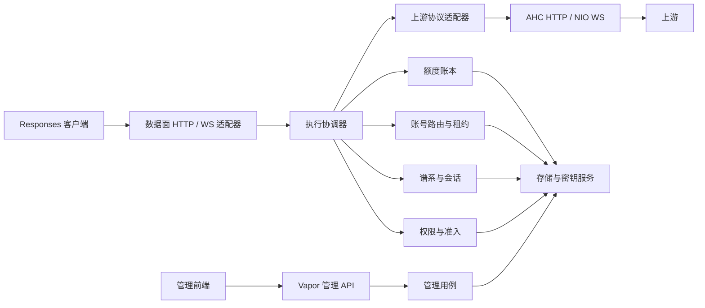

# CodexOne 正式产品架构提案

状态：独立设计稿，供评审与决策；不是已经批准的需求，也不是原型实现说明。  
资料核对日期：2026-10-21。  
范围：开源、自托管、面向 Codex 等 Responses 客户端的账号池与 API 网关。

## 1. 设计立场与信息边界

CodexOne 应成为一个可信的访问与执行边界：知道谁可以使用什么能力，知道一次执行属于哪个上游身份，能在长连接、取消和失败中保存正确的资源与额度状态，并让管理员解释发生了什么。产品的核心资产是这些可验证的语义、兼容性夹具和运维能力。

本提案只依据给定背景、根 AGENTS.md 与公开一手资料；没有阅读实验报告、原型实现或 codex-lb 实现，没有访问真实账号、凭证或 Ali 服务。已有可行性实验降低的是技术探索风险，不能替代生产条件下的兼容性、资源、安全与记账验收。

### 已知方向

- 独立重写并开源；后继项目名称为 CodexOne。
- 覆盖 HTTP 流式与 WebSocket 代理、上游账号和授权、会话连续性、API Key 权限与限额、图片、管理界面和运维。
- Swift + Vapor 是拟定主栈，可使用 SwiftNIO、AsyncHTTPClient；前端可自由选择。
- 初期小规模自托管，服务器可能资源有限；编译可以在 GitHub CI 完成。
- 不修改、不部署现有 Ali 服务。

### 用于本稿的假设

以下均可被用户调整：首版是一个管理员控制的信任域；客户端通过本地 API Key 接入；上游身份由管理员合法持有或获得授权；首版单节点、单进程；希望可安装、可升级、可恢复，优先于跨地域高可用；“限额”首先用于内部访问治理，不默认构成向第三方收费的结算系统。

“账号授权”尚不能推导为任何具体 OAuth 流程或订阅账号转 API 的许可。公开 OpenAI API 文档也不能证明其他账号后端具有相同协议、额度、图片能力或授权权利。首个发布版本必须明确声明所支持的上游种类与实测契约；无法确认的后端保持实验标记和默认关闭。

## 2. 产品边界与首版切片

### 默认推荐

首版支持一个上游协议族的多个身份，HTTP Responses（普通 JSON 与 SSE）和原生 Responses WebSocket；提供最小账号管理、API Key 策略、请求诊断、额度账本、备份恢复与图片输入。图片生成以 Responses 工具路径为优先；独立 Images API 作为同一能力模型下的后续端点，不为了“全能网关”提前适配 Chat Completions、Realtime、音视频或任意第三方协议。

一个实际可用的发布切片应完整包含：管理员安全初始化 → 添加受支持的上游身份 → 创建受限 API Key → Codex 完成多轮工具调用 → 查看会话归属和用量 → 撤销 Key → 备份并在干净机器恢复。不能只用一个 echo 代理定义 MVP。

| 产品面 | 首版承诺 | 首版不默认承诺 |
|---|---|---|
| 客户端兼容 | 明确版本范围的 Codex 与选定 Responses SDK；发布兼容矩阵 | 所有 OpenAI 端点、所有 Codex 历史版本 |
| 账号池 | 资格筛选、容量租约、健康分类、受约束切换 | 任意错误自动跨账号重试、自动注册账号 |
| 会话 | 响应谱系与账号归属、连接内续接、明确恢复错误 | 无正文留存情况下无损恢复任何断线 |
| 配额 | 原子准入、预留、可追溯结算、未知用量处理 | 上游缺乏上界时绝不超支的金额保证 |
| 管理 | 单管理员起步，操作审计、脱敏诊断、导入导出 | 公网多租户 SaaS、支付与发票系统 |
| 图片 | 权限、大小与并发限制，保持上游结果语义 | 内置相册、自动保存所有生成图片 |

## 3. 必须长期保持的业务不变量

1. **身份不混用。** 本地 API Key、上游凭证、上游账号身份、客户端会话是不同对象。任何一次上游执行都有唯一的本地 request ID、attempt ID、上游身份与策略版本。
2. **归属约束优先于调度分数。** `previous_response_id`、文件 ID、会话对象、压缩结果及其他上游私有对象只在已知所属身份内使用。归属冲突必须拒绝，不能“再试另一个账号”。客户端随意提供的会话字符串不是归属证明。
3. **执行边界不能逆转。** 上游可能已接受一次请求、或客户端已经观察到输出后，不能透明地把它变成另一份执行。网络不确定性必须记录，不能归类为“未产生费用”。
4. **账本结算本地幂等。** 同一预留只能被释放、结算或转为待核对一次；后续更正用追加调整记录。重试产生独立 attempt，但不重复为同一次本地最终结果入账。上游费用仍可包含多个 attempt。
5. **资源有所有者和上界。** 请求、WebSocket 连接、lane、上游连接、读写泵、计时器与后台工作都由明确的生命周期拥有；队列同时受字节数和条目数限制，连接总量与图片并发另设上界。
6. **取消不是成功，也不是免单证据。** 客户端断开要传播取消和清理，但本地取消不证明上游停止生成；没有最终用量时必须保留不确定状态。
7. **授权先于占用。** 未认证、超限、能力不允许的请求不能取得上游凭证、连接或账号执行槽；已建立的 WS 每次创建响应仍要重新准入。
8. **隔离先于便捷。** 对象查找按本地访问主体隔离；不可仅凭猜中的 response ID 获取他人的内容或借用其上游身份。
9. **内容默认不落盘。** 诊断、审计、指标、崩溃报告默认不包含正文、图片、Authorization、刷新令牌或带签名 URL。恢复能力不能悄悄改变留存政策。
10. **进程内并发安全不等于事务正确。** actor 和 Swift 并发检查不替代数据库唯一约束、事务、跨进程 fencing，也不证明取消传播正确。

这些规则应先转为正式规范和验收夹具，再选择实现细节。本稿尚不直接改写项目的实验规范或创建实现任务。

## 4. 运行形态与模块依赖

推荐模块化单体：一个可执行文件，一个持久数据库，一个静态管理前端；可以在进程内分别绑定数据面与管理面监听地址。默认管理面只绑定 loopback；部署者通过受控 TLS 入口暴露。模块是编译依赖边界，不是微服务。



| 模块 | 职责与边界 |
|---|---|
| Domain | 值类型、状态、错误分类、资格规则、路由约束、计量单位；不依赖 Vapor/NIO/ORM |
| Application | 执行协调器、管理员用例、端口协议、事务用例；依赖 Domain |
| ProtocolResponses | 有界 JSON/SSE/WS 事件识别、兼容配置、对象 ID 与 usage 提取；不负责选账号或直接扣额 |
| Transport | HTTP/WS 生命周期、头处理、背压与取消；把受限事件与字节流交给用例 |
| Upstream | 上游认证注入、能力目录、错误归一化、刷新与传输；每个支持后端有独立契约测试 |
| Persistence | 版本化迁移、事务、唯一约束、查询；将 ORM 模型转换为 Domain 值，不向外泄露连接 |
| ControlPlane | Vapor 管理 API、管理员认证、审计、静态文件；不直接更改热路径内存字典 |
| Runtime | 生命周期、任务监督、配置、指标、优雅关闭与命令行维护工具 |

执行协调器不是无所不包的巨型代理类。它只编排有限步骤：认证 → 解析与限制 → 资格与归属 → 原子准入 → 账号租约 → attempt → 传输 → 最终化。具体规则由小型、可独立测试的领域组件实现；不为每个函数建立协议，只在外部 I/O、时间和策略变化边界建立端口。

## 5. 技术栈建议与可替换边界

### Swift、Vapor 与数据面

保留 Swift 作为正式主栈建议：团队投入能集中形成类型化协议、状态机与并发生命周期资产。使用 Swift 6 语言模式和严格并发检查；固定经 macOS/Linux CI 验证的工具链与 Package.resolved，不仅写一个随时间漂移的“最新版”。目录目前要求实验使用 Swift 6.4；正式产品的最低版本应由依赖与 Linux 构建验证确定，不能从编译通过推导运行保证。Swift 的检查主要约束可证明的数据竞争；本稿仍要求状态机和并发失败测试。[Swift 官方迁移文档](https://www.swift.org/migration/)

Vapor 用于管理 API、认证路由与生命周期整合；HTTP 数据面默认先评估 Vapor 的流式接口，在生产级取消、写完成背压与半关闭验收通过时复用同一监听器。若高层接口无法以公开 API 满足约束，则数据面采用一个窄的 NIO 适配器，管理面继续 Vapor，领域与协调器完全复用。**不因原型成功就预先永久保留两套数据面。** 最迟在第一个正式切片结束时选择一条默认路径，另一条只保留必要的对照夹具或移除。

Vapor 文档证实其建立在 NIO 上，并同时提供 future 与 async 接口；这不能证明任意流式响应会自动绑定客户端断开。应把模型转换限制在适配层，不在同一路由随意混用事件循环与任务模型。[Vapor Async](https://docs.vapor.codes/basics/async/)

上游 HTTP 使用进程级长寿命 AsyncHTTPClient，明确连接池、超时、重定向禁用与关闭顺序。其官方 README 描述流式 body 的迭代背压；只有迭代与下游实际写完成相连，且中间没有无界缓冲时，这一能力才构成端到端背压。[AsyncHTTPClient](https://github.com/swift-server/async-http-client)

WebSocket 客户端使用 NIOWebSocket 或经过验证的 WebSocketKit 适配器；不要假设 AHC 的 HTTP streaming 等于 WebSocket 客户端。Vapor 文档提供 WS 客户端、发送完成和关闭通知接口；仍需验证读侧暂停、分片累计、压缩与关闭握手是否满足资源约束，必要时下沉 NIO。[Vapor WebSockets](https://docs.vapor.codes/advanced/websockets/)、[SwiftNIO 官方仓库](https://github.com/apple/swift-nio)

### 存储与前端

默认推荐 SQLite WAL，以单机本地磁盘部署；牺牲水平扩容和多写节点，换取少一个常驻服务与完整快照恢复路径。首版只实现一种数据库。通过 SQLKit/SQLite 驱动与显式 SQL 事务实现准入和账本，普通管理 CRUD 可用 Fluent；避免让 ORM 隐藏条件更新和受影响行数。具体驱动组合要先完成事务、取消与繁忙处理的窄验证，再锁版本。Fluent 官方支持 SQLite 和 PostgreSQL；这不意味着两者事务行为或迁移 SQL 可无成本互换。[Fluent](https://docs.vapor.codes/fluent/overview/)

SQLite WAL 允许读写并行但仍只有一个 writer，并要求同机共享内存，不能放网络文件系统。因此短事务、分页查询、有限繁忙重试和数据库线程池是部署契约。PostgreSQL 是未来多实例的默认升级目标；不首发双后端。[SQLite WAL](https://www.sqlite.org/wal.html)

前端推荐 TypeScript + React + Vite 静态 SPA，构建产物随发行版发布，运行时无需 Node。原因是复杂表单、状态诊断、可访问性与贡献者生态；不是性能优势。若维护者明确偏好更小的交互模型，可采用 Svelte；不采用 Next.js SSR，因为此管理台没有必须 SSR 的产品需求。浏览器不能直连上游或持有其凭证。

Redis、消息中间件、Kubernetes、自研插件系统、任意路由 DSL、向量数据库和完整事件溯源均不进入首版。账本追加记录不意味着把所有 CRUD 变成事件溯源。

## 6. 协议兼容与传输语义

### 兼容模型

将“兼容”定义为版本化的端点、头、请求字段、流式事件、错误与对象生命周期矩阵，分别列明公开 API 后端、其他账号后端、Codex 版本。公开官方契约与实际客户端行为是两种证据；一个不能代替另一个。官方 WebSocket 文档当前已经包含 `stream_id` 多路复用，不能固化“一连接只能一个响应”的旧假设。[Responses WebSocket Mode](https://developers.openai.com/api/docs/guides/websocket-mode)

HTTP 默认提供 `POST /v1/responses`；普通与流式语义都应测试。compact、读取、删除、文件与独立 Images 端点只能在明确声明并有归属隔离后开放。不做任意 URL 转发。规范路径、选定等价路径、尾斜杠、query、未知字段、Content-Type 和重复头的处理必须写入契约；WS upgrade 不依赖客户端跟随重定向。

采用“有限理解、其余透明”的事件策略：只解码准入、归属、生命周期、usage 与安全必需字段；保留允许的未知字段和事件，不把整个上游 schema 重建为易落后的封闭枚举。对未知且影响授权/归属的能力字段则拒绝或要求显式支持，不能借透明透传绕过权限。转发头使用允许列表，剥离 hop-by-hop、本地凭证、Cookie 与未经信任的身份头；只注入服务器生成的上游授权。

### HTTP 生命周期

```text
received -> authenticated -> validated -> reserved -> leased
         -> dispatching -> upstreamAccepted -> downstreamCommitted -> streaming
         -> terminalObserved -> finalized -> closed
任何非终态 -> cancelling / failed / indeterminate -> finalized -> closed
```

`dispatching` 表示请求可能已发出；`upstreamAccepted` 必须来自已观察证据；`downstreamCommitted` 表示响应头/字节已向客户端提交，不能再改 HTTP 状态。将这些事实分开存储，不能以“还没首 token”判断可重试。

SSE 是有边界的事件流，不是按换行猜 JSON。解析需覆盖任意 UTF-8/CRLF/多行 data/网络切块，原始可转发数据不因解码重排。只为提取元数据维护受限事件窗口；图片 base64 大事件超过窗口时按明确端点大小策略处理，不能无限收集。HTTP streaming 使用 SSE 是官方契约，终态可能是 completed、failed、incomplete 或 error，TCP EOF 自身不是成功。[Streaming Responses](https://developers.openai.com/api/docs/guides/streaming-responses)

### WebSocket：连接、lane 与 turn 三层

- **ConnectionContext**：认证主体、固定上游身份、上游 socket generation、总缓冲、任务组、关闭状态。首版一个下游连接对应一个上游连接，不跨用户共享 socket。
- **LaneContext**：连接内 `stream_id` 或隐式 default lane、FIFO、有界等待队列、当前 turn、最近谱系。不同 lane 可并行，但受账号与 Key 的 aggregate 限制。
- **TurnContext**：独立准入、预留、attempt、响应 ID、终态与结算；不能只在握手时扣一个“连接请求”。

首版整个 WS 固定一个上游身份，代价是 lane 无法各选最空闲账号，收益是跨 lane 分叉与上游连接缓存语义可保持。不能把多个账号事件混进一个 socket 再宣称原生兼容。HTTP 新会话仍可单独调度。

每次 `response.create` 按连接主体重新检查 Key 启用状态、策略版本、能力、额度与排队容量；同 lane FIFO，跨 lane 的终态和错误按 `stream_id` 关联，request-scoped 错误不能随意关闭无关 lane。无法关联且破坏连接可信状态的协议错误关闭整个连接并最终化全部活动 turn。未知 ID 的使用不能越权。

官方文档当前说明同 lane 不重叠、不同 lane 可并行、连接最长 60 分钟；这些是该公开上游当日资料，不应硬编码为所有后端常量。连接上限、lane 个数和本地更小的运营上限由能力描述与兼容测试锁定。本地不擅自轮换一个仍有活动 turn 的上游连接。[WebSocket 连接行为与恢复](https://developers.openai.com/api/docs/guides/websocket-mode#connection-behavior-and-limits)

## 7. 会话连续性与对象归属

持久表保存最小的 `ResponseBinding(subject, upstreamIdentity, responseID, parentID?, socketGeneration?, observedState, expiresAt)`；对象 ID 不单独全局唯一，命名空间至少包含后端与上游身份。原始 ID 不必改写，但对外查找必须先校验主体。绑定在观察到有效 response ID 后创建，不能等账本成功才开始记录所有权。

`previous_response_id` 是谱系，不是完整会话内容；客户端会话 ID 是调度提示，不是访问凭证；上游连接缓存是临时性能与可用性条件，不是持久会话。新增请求的路由约束取所有引用对象归属的交集，交集为空就返回明确错误。

默认只支持同一本地访问主体续接；Key 轮换通过稳定的 principal 归属保持连续性。是否允许同一工作区内不同 principal 共享谱系，应作为单独权限决定，不能默认通过共同账号隐式共享。

**默认不做服务器端全量历史重建。** 断线后先按绑定在同一身份重连；若上游找不到状态，将 `previous_response_not_found` 等错误交给客户端，要求其以完整上下文或已压缩窗口发起新请求。官方文档说明 store=false 的连接缓存丢失后没有持久回退；store=true 的恢复也依赖上游可解析该 ID。网关不可仅有映射表就承诺恢复，也不能自动改 `store=false` 为 true。[官方恢复说明](https://developers.openai.com/api/docs/guides/websocket-mode#reconnect-and-recover)

可选的“网关托管历史”将改变隐私、存储、图片和工具调用语义，必须另立功能：明确同意、加密与 TTL、上下文重放规则、工具副作用边界和删除机制；不进入首版默认行为。

例如：A Key 的 turn 在账号 U1 返回 R1；U1 被限流，客户端以 R1 续接。系统只能等待 U1、明确失败或让客户端主动以完整上下文新建，不能选择 U2 并继续发送 R1。若客户端创建不含 U1 私有对象的全新请求，才可重新调度。

## 8. 上游身份、凭证与账号池

### 模型与授权

分开建模 `Provider`（协议与可信 origin）、`UpstreamIdentity`（稳定身份/组织/项目）、`CredentialVersion`（可轮换密文）、`Capabilities`（能力证据）、`PoolMembership`（管理员授权的用途）。刷新令牌不是账号标识；不能因 token 更新创建“新账号”而丢失绑定。

首版支持管理员导入受支持的凭证，或提供者明确支持的正式授权流程。授权回调需一次性 state、短 TTL、绑定发起管理员与目标 origin；若某提供者要求 PKCE 则完整实现。不要自行模拟未确认的授权接口、上传浏览器 cookie 或在日志显示 token。具体登录方式与支持后端是待决项。

凭证用带认证的加密存储，密文携带 key version；主密钥通过只读 secret 文件或部署密钥服务注入，不写入数据库、镜像或管理前端。主密钥缺失时拒绝启动数据面。备份数据库与主密钥分开保管；支持轮换和再加密。管理 UI 只显示指纹、权限、过期和刷新结果，不允许常规明文回读。

### 刷新与运行状态

每个身份单飞刷新，凭证版本 compare-and-swap；刷新工作有超时、有所有者、被多个请求等待时不会由第一个请求取消而销毁。独立 supervisor 拥有刷新任务，等待者取消只退出自身。旧凭证失效错误不能覆盖更新后的版本。网络超时不等于永久 revoked；仅确凿认证失败进入 requires_auth。

账号状态拆为正交维度：管理员 enabled/draining/disabled；授权 ready/refreshing/requires_auth；能力 model/tool/transport；健康 healthy/suspect/open/half-open；限流按模型或容量组 cooldown。不能用一个 unhealthy 布尔值表示所有情况。

路由先做硬资格与归属筛选，再按剩余容量、在途负载、冷却、稳定性和公平性排序。初期采用可解释的最少在途加稳定散列打散，不引入机器学习调度。每次选择原子取得容量租约；失败账号加入本次 attempt 排除集合，重试预算和总 deadline 都有限。

主动探测默认仅非生成式、无付费或无账号调用的探测；只有操作者明确启用才做真实请求。被动健康使用分类证据：客户端取消、慢消费者、本地超载、解析限制不能惩罚账号；认证错误和上游 5xx/限流分别处理。排空停止新请求，但允许已绑定的进行中 turn 完成；强制禁用/撤销的终止策略需要 UI 明示。

## 9. 权限、额度与账本

本地 API Key 是高熵随机 secret，首次显示一次，持久存其不可逆验证值和公开前缀；本地 key 不发送上游。principal 独立于 key，支持轮换与撤销。权限包含端点、模型、工具/图片、可用 pool、对象访问范围、并发与请求大小；管理权限完全独立，不以普通 API Key 访问管理员接口。

区分三类限额：请求速率/并发用于容量保护；token/图片数量/业务 credit 用于使用治理；货币金额用于估算或严格预算。不要把上游订阅剩余额度当作本地可支配账面余额，也不要把估算价展示成官方实际账单。

### 原子准入与最终化

1. 事务读取当前策略版本、Key 启用与过期、窗口；条件更新额度占用，建立唯一 reservation，写 request intent。只有事务提交才允许发往上游。
2. attempt 在上游发送前记录身份与凭证版本；持有有界账号执行租约。等待选账号与等待刷新均纳入请求期限。
3. 读取终态 usage，保存原始计量维度、来源和计价版本；事务唯一结算 reservation，追加 ledger entry，释放余额预留。网络资源在 finally 中释放，不依赖健康状态写入成功。
4. finalization 作为 runtime supervisor 拥有的有限工作，脱离已取消的客户端 task，但不脱离进程监督；截止时间内重试，失败保留 durable pending，由恢复工作继续。不能无限 shield 网络生成。
5. 无终态、进程崩溃或已发送后不确定时标记 pending_reconciliation；没有证据不能释放为零用量。管理台单列 pending 数量、预留金额和最老年龄。

建议 reservation 状态为 `held -> settled | released | pending_reconciliation`，pending 可经核对转 settled/released；ledger entry 的业务唯一键阻止重复结算。请求状态、上游 attempt 状态、账本状态是不同字段，不能用“请求已取消”覆盖“用量未知”。

如果上游与数据库之间没有分布式事务，也没有可查询的幂等键，就无法保证上游 exactly-once。崩溃可能发生在“意图已落库但请求未发出”或“请求已执行但终态未落库”之间。恢复只能保守标记未知，不能靠本地 request ID 虚构上游幂等性。

### 硬预算的真实限制

默认建议首版使用请求/并发硬限制和 token/图片业务预算，金额为带标记的估算；为 token 预算按可验证的输入与最大输出上界预留。若模型/工具无可靠费用上界，必须选择“拒绝该能力用于严格预算”或“允许有界运营风险”，不能只预留一个平均值便称硬限额。图片、缓存 token、推理 token、工具费等维度分别计量，整数最小单位与固定精度计算，禁止浮点余额。

客户端取消后默认保留该请求预留，直至拿到可信用量或进入核对流程。自动过期不应直接退款：可配置保守收取上限或管理员调整，但要披露其与上游真实费用可能不同。价格表、窗口时区（推荐 UTC）、跨窗口结算规则（按准入窗口归属）、Key 撤销时的在途处理都需要规范化。

账本失去写入能力时停止新准入；已在途请求尽可能排空，最终化失败变为恢复时可识别的 pending。健康统计不能阻塞结算，诊断统计可以异步丢弃。不要在流式期间持续持有数据库事务。

## 10. 存储、一致性与后台工作

持久数据至少包含 providers、identities、credential_versions、principals、api_keys、policies、pool_memberships、requests、attempts、reservations、ledger_entries、response_bindings、object_bindings、audit_events 和 schema_migrations。短 TTL 连接状态、细粒度 token bucket、字节队列不落库；API Key 撤销和额度不能只依赖永不过期的内存缓存。

首版一个 Runtime actor 管理路由快照版本和任务目录；每身份/连接 actor 隔离局部状态。重要更新在数据库提交后发布新版本，使用短期缓存和显式 invalidation；长期 WS 每 turn 读取足够新的授权信息。actor 重入的 await 前后必须重新校验租约/版本，不能把跨 await 的内存检查当作原子操作。

数据库保持唯一与外键约束，reservation 与余额条件更新在同一短事务，绑定和账本有业务唯一键，所有时间记录 UTC。SQLite blocking I/O 放有限线程池，不能阻塞 NIO event loop 或 Swift 协作线程。对 SQLITE_BUSY 只进行有上限、带抖动重试，超时返回容量错误；后台报表使用分页与只读短事务，避免长读阻塞 checkpoint。

内置受监督后台任务只包括凭证刷新、pending 核对、TTL 清理、备份和轻量聚合；并发与间隔均有边界。关键工作以持久状态为事实，不能“往内存队列塞一下”就认为可靠。若未来存在外部通知，再引入同事务 outbox，首版不提前建立通用工作流引擎。

启动恢复：检查迁移版本、密钥和数据库完整性 → 将旧 boot ID 的进行中 attempt 标记未知并处理预留 → 载入策略与身份 → 启动监听。首版不允许两个进程同时作为数据面写者；通过实例锁强制执行。未来多实例必须增加数据库租约、epoch/fencing 和 owner 路由，不能只删除锁。

## 11. 并发、背压、取消、超时和重试

### 所有权与资源预算

一个连接 supervisor 拥有所有 reader/writer/heartbeat 子任务；一个 turn scope 拥有上游执行和 deadline。任何一侧异常，取消相应 task，关闭必要的网络侧，await 子任务退出，再释放租约和排队容量。只有可恢复的最终化被移交 Runtime supervisor；禁止任意 `Task.detached` 逃逸。

配置以少量“安全资源档位”起步，保留必要覆盖项：全局/每 Key/每身份活动响应、HTTP/WS 连接、每 WS lane、总队列条目与字节、单帧/累计消息、最大 JSON/SSE 事件、总请求与图片大小、慢写 deadline。计算峰值内存要包括连接数 × 每连接缓冲 + 活动 turn × 解析窗口 + 大图片事件 + 驱动连接池，而非只限制单个队列。初始数值是待压测的运营默认，文档不承诺未经测试的吞吐或内存优势。

读到下游写完成才推进上游读取；达到高水位暂停读取，低水位恢复；到达硬上限拒绝新 work 或明确终止慢消费者。仅 `await send` 不证明远端已收到，但可用于约束本地写缓冲；需要实际 socket 夹具验证。WS 分片累加、控制帧与业务帧都受累计限制；压缩首版默认关闭，防止放大与复杂内存行为。

### 取消与超时

分别配置并观察排队、连接/TLS、响应头、首语义事件、活跃进展、下游写、总 turn 和连接寿命；图片生成的长静默和模型思考需要不同 idle 策略。Ping/pong 说明传输存活，不说明推理进展。超时使用单调时钟，额度窗口使用 UTC 日历时间。

客户端断开后立即停止向其写；取消上游任务并尝试关闭或协议取消，在有界时间后强制清理。协议支持的 turn 级取消只作用于对应 turn；不支持时不能为了取消一个 lane 隐式杀掉其他 lane 而没有记录。若只能关闭整个上游 socket，应明确终止全部活动 lane，并全部进入各自最终化。

### 默认保守重试表

| 证据/失败 | 默认动作 |
|---|---|
| 本地验证失败、无可用资格账号 | 不发上游，释放未执行预留，返回可解释错误 |
| 取得凭证前失败、确定未发送任何请求 | 在总预算内重选；有归属约束则仍限同身份 |
| 上游明确拒绝且适配器证明未执行 | 可按错误契约有限重试；先结束 attempt 与资源租约 |
| 请求已发送后超时、断线、未知接受状态 | 不透明重放；pending 与明确失败 |
| 已提交下游、已收到 response ID 或任何语义输出 | 不透明重试；保持终态或异常结束 |
| 429/账号冷却 | 尊重 Retry-After；不让固定谱系跨账号；新独立请求可选其他资格账号 |
| 401 旧凭证 | 对版本相关错误单飞刷新；仅在明确拒绝未执行且无输出时最多重试一次 |

首 token 前自动重试也可能重复付费，因此默认不采用“首 token 前随便重试”规则。跨账号 failover 必须同时满足：无上游私有对象、主体允许、未产生可观察输出、适配器证明重放安全、总 attempt 数有界。没有明确契约的 5xx 不等于安全拒绝。

## 12. 错误语义与安全边界

对外错误保持协议 envelope；网关错误用稳定 code、脱敏 message、本地 request ID 和可选 retry 信息，不泄露账号邮箱、token、真实内部地址与原始数据库错误。建议至少区分 auth_invalid、permission_denied、quota_exceeded、capacity_unavailable、binding_conflict、upstream_auth_required、upstream_unavailable、upstream_state_lost、client_too_slow、execution_indeterminate。最终 code 的前缀和映射需与客户端兼容夹具决定。

HTTP 提交响应前用合适的 4xx/429/502/503/504；提交后使用协议允许的错误事件，否则异常结束，绝不伪造 completed。WS 握手前返回 HTTP 错误，握手后用请求级协议错误或有依据的 close code；不能发明 HTTP 状态响应。上游原始错误仅保留经过允许列表清洗的字段，request ID 可单独关联。

安全要求包括：上游 origin 允许列表、TLS 验证强制开启、重定向默认关闭、DNS/IP/端口策略防 SSRF；用户可配置的自定义上游需管理员特权，显式允许私网而不是默认跨网。网关不主动抓取任意图片 URL；确需下载时使用独立受限抓取器并防 DNS 重绑定。上传/下载限制应用于解压后的累计字节与 multipart 分段总量。

管理面使用独立管理员 session、HttpOnly/Secure/SameSite cookie、CSRF 与 Origin 检查、速率限制；支持反向代理身份时明确可信代理范围，不能盲信 Forwarded/X-Forwarded-*。首次初始化采用一次性引导秘密，不默认密码；高风险操作再次验证管理员身份，并审计操作者、对象、结果和前后版本。删除账号应先排空并展示绑定影响，不做无提示级联删除账本。

Key 撤销默认阻止新的 HTTP 请求与 WS turn，已在途生成允许完成；紧急撤销可主动终止在途但仍结算。这个默认兼顾可预期性与成本，需用户拍板。日志脱敏在 sink 之前完成，调试开关不能把所有请求正文自动记录。

## 13. 图片能力的特殊处理

图片输入、Responses 的 image generation tool 与独立 Images API 是三种能力，分别授权与计量。官方文档区分独立生成/编辑端点和 Responses 会话工具，因此不应把“能转发 input_image”展示成“完整图片生成支持”。[OpenAI Image Generation](https://developers.openai.com/api/docs/guides/image-generation)

预先声明模型、工具参数、格式、大小、文件对象、multipart、部分图片事件与最终 usage 的支持矩阵。base64 输出可很大：保持流式传输，限制单事件/总响应大小与图片并发；不要在管理数据库保存 base64，不为 usage 统计解码完整图片。预算不能只按文本 token 收取。

默认图片仅透传，不建立资产服务；文件 ID 与生成结果引用绑定上游身份。若要提供短期下载链接，则引入明确的资产 TTL、不可猜测 ID、主体校验、磁盘配额、签名过期与清理恢复流程。上游安全拒绝保持原始语义，不能当账号不健康绕路重试。

## 14. 可观测性、管理体验与日常运维

管理员首先需要回答：请求在哪一阶段、为何选此身份、是否已发上游、是否还占槽、何时取消、用量是否最终确定、续接为何失败。管理台围绕这些问题组织，而不是只显示账号“在线/离线”。

首版页面建议为总览、上游身份、API Keys/策略、请求与会话诊断、用量/待核对、设置/备份；避免继续添加核心导航。请求详情显示脱敏时间线和关联 ID、失败分类、策略版本、计价版本与待核对原因；默认不显示正文。权限拒绝和容量不足需要可行动的文案。

结构化日志与 trace 关联本地 request/attempt/connection/lane，凭证仅指纹。指标覆盖：各阶段延迟、首事件、活动 turn/连接、队列字节、写等待、取消到上游释放时间、超时类别、账号 cooldown、刷新结果、预留/pending/结算、DB busy/延迟、RSS/文件描述符与 task 数。API Key、response ID、会话 ID 不作为 metrics label，防高基数与泄露。

建议使用 swift-log、swift-metrics，通过适配器导出 Prometheus 格式；trace 以 OpenTelemetry 兼容为目标，但 Swift exporter 的版本、维护和 Linux 支持需独立验证，首版可以结构化关联日志交付，不因 exporter 阻塞核心语义。诊断采样和统计队列可降级丢弃，安全审计和账本不能无声丢失。

## 15. 发行、升级、恢复与容量管理

发布 Linux amd64/arm64 OCI 镜像及校验和，构建阶段包含 Swift/Node，运行阶段只含服务、静态文件和必要运行库；非 root、只读根文件系统、独立 data 与 secret 挂载。CI 在 Linux 实际运行网络夹具，不以 macOS 通过替代。编译资源与运行资源分开测量，不能用 Swift 二进制预期推导低 RSS。

提供 Compose 和 systemd 两条明确安装路径，可选反向代理负责 TLS。反向代理配置必须涵盖 SSE 禁止缓冲、WS Upgrade、长连接期限、body 限制、可信转发头和 shutdown；不支持的设置应在诊断页可见。开发默认 loopback，公网开放必须有显式监听与 TLS 部署文档。

`live` 表示进程可调度；`ready` 表示完成迁移、数据库可用、主密钥可加载且允许准入；没有可用上游账号应反映业务容量状态，不导致无限重启。不要在健康探针中付费调用模型。

关闭流程：停止新准入 → 标记 draining → 停止新 turn → 限时排空 HTTP 与 WS → 终止仍活动工作并记未知 → flush 最终化与审计 → 关闭 AHC/DB/event loop。长时间 WS 不应让升级永远无法完成；到达排空 deadline 明确断开，客户端恢复遵循第 7 节。单节点升级默认有短暂停机，不宣称零停机。

迁移使用显式 CLI、单实例锁、版本检查和先备份；尽量 expand/migrate/contract，破坏性迁移需新版本单独执行。不能因为服务自动重启而自动执行不可逆迁移。回滚必须区分二进制兼容回滚与恢复数据库快照；后者可能丢失快照后的账本，需要维护窗口与恢复说明。

SQLite 在线备份采用官方 backup API 或等价一致性快照流程，不直接复制活跃 .sqlite 文件后忽略 WAL；备份保留与加密、密钥单独恢复和离机副本均需文档。每次发布至少演练从干净环境恢复账号元数据、策略和账本，确认历史活动请求转 pending。SQLite 官方介绍在线备份 API 的一致性快照能力。[SQLite Backup API](https://www.sqlite.org/backup.html)

先测目标主机的单连接内存、图片峰值、慢消费者、长 WS、磁盘满与 DB busy；再给出资源档位和容量建议。默认背压与拒绝过载，不能靠无界队列伪造稳定吞吐。何时迁移 PostgreSQL/多实例由写入等待、恢复目标和可用性需求触发，而非单纯账号数量。

## 16. 演进顺序与可验收门槛

| 阶段 | 交付与退出条件 |
|---|---|
| A：契约与垂直骨架 | 明确首个上游身份类型、Codex 范围、路径和存储决策；写正式规范；Linux fixture 上跑通认证、一次普通/SSE 请求、durable 预留与结算、取消清理、备份恢复 |
| B：可信账号池 | 多身份资格/归属、单飞刷新、限流分类、幂等本地账本；证明固定对象不能跨账号、同额度并发只允许合规数量、重复终态不重复结算 |
| C：会话与原生 WS | 多 lane FIFO/并行/分叉、每 turn 权限、aggregate 限制、连接丢失与恢复；选择唯一默认数据面；真实客户端验证只在另行授权的隔离环境 |
| D：可安装首版 | 完整管理闭环、图片输入与选定生成路径、脱敏审计、故障注入、发行镜像、升级/回滚/恢复手册；公布支持矩阵与已知限制 |
| 后续按证据投入 | 独立 Images/文件服务、托管历史、PostgreSQL、多实例、细化 RBAC；每项有独立需求与迁移设计 |

必须从真实产品入口验证，而不只测纯 helper：HTTP 首字节/中途/终态附近断开；上游静默、慢下游、半关闭；SSE 任意切块与大图片；WS 分片、ping、lane 交错和请求级错误；Key 在长连接中撤销；认证刷新竞争；响应归属冲突；磁盘满、数据库失败、进程在发送/观察终态/结算间被 kill；重复 finalization；重启后 pending 不丢失。

性能验收使用事先写明的目标硬件、并发、负载形状、持续时间和 RSS/队列/FD/task 基线。建议把“客户端断开到上游资源释放 p99 在 2 秒内”作为待验证目标，单列上游确实停止生成是否可观测，不能把释放 socket 当作停止收费证明。长时间压力后资源回到稳态、无持续队列增长，比单次峰值吞吐更适合作为首版门槛。

协议快照夹具去除敏感数据后可纳入仓库；同时保留未知事件、图片和 error envelope 兼容性测试。官方文档或 Codex 更新后先更新兼容矩阵与夹具，再开放新能力。所有实验都记录真实验证范围，不能用模拟上游验证官方账单或所有账号后端。

## 17. 需要用户拍板的实质选择

| 选择 | 本稿默认建议 | 代价或替代 |
|---|---|---|
| 首个正式上游 | 选择一种权利、认证流程与协议可明确验证的身份类型，其他标实验 | 若必须优先订阅账号后端，就接受独立适配、兼容漂移与授权确认工作，不能套用公开 API 保证 |
| 使用主体 | 单管理员信任域、稳定 principal、多 API Keys | 公网多租户需要更强隔离、滥用处置和运营责任，首版周期显著增加 |
| 续接与隐私 | 不留正文；映射归属，恢复失败交回客户端 | 无法透明恢复所有断线；托管历史提高恢复能力但增加敏感数据与复杂度 |
| 预算含义 | 请求/并发硬限，token/图片治理，金额明确标估算 | 严格金额上限要求可验证费用上界，部分工具/后端需拒绝或限制 |
| 未知用量 | 保留预留并待核对，管理员可审计调整 | 用户余额可能暂时被占；自动退款更顺畅但会低估真实成本 |
| 存储 | 首版 SQLite WAL，仅单节点，未来迁移 PostgreSQL | 多实例/高可用若是首版刚需，应直接 PostgreSQL，接受常驻服务和运维成本 |
| WS 账号亲和 | 整个连接绑定一个上游身份 | 可解释并保留分叉语义，但单连接无法按 lane 分散到不同账号 |
| 撤销与排空 | 普通撤销阻止新 turn，在途完成；紧急撤销终止并结算 | 立即杀所有请求更强硬，但可能浪费工作并留下未知用量 |
| 图片首版范围 | 输入与 Responses 工具路径先完整，独立 Images 随后 | 如需独立图片客户端首发，就扩大 multipart、文件与错误兼容验收 |
| 开源定位 | 自托管网关；先选许可证与贡献准则，保留清晰上游适配边界 | 许可证、商标和收费运营不应由架构稿代替维护者决定 |

上述问题中，首个上游类型、信任域、预算含义与内容留存最先决定业务契约；其余可采用默认建议进入正式规范。未拍板前可以继续做无凭证夹具、事务与生命周期验证，不能把假设写成对外功能承诺。

## 18. 一手来源与证据边界

本稿使用的一手来源均于 2026-10-21 读取；链接随上游演进可能变化，实施时应锁定依赖版本并记录兼容矩阵。

- [Responses WebSocket Mode](https://developers.openai.com/api/docs/guides/websocket-mode)：原生 WebSocket、lane 顺序/并发、连接缓存、恢复与限制；只证明公开 API 当日文档。
- [Streaming API Responses](https://developers.openai.com/api/docs/guides/streaming-responses)：SSE 与语义事件；不证明其他账号后端字节流一致。
- [Image Generation](https://developers.openai.com/api/docs/guides/image-generation)：独立 Images 与 Responses 工具路径的区别；账号可用性仍需单独确认。
- [Swift Migration Guide](https://www.swift.org/migration/)：Swift 6 并发数据竞争检查；不替代业务并发正确性与系统可靠性证明。
- [Vapor Async](https://docs.vapor.codes/basics/async/)、[Vapor WebSockets](https://docs.vapor.codes/advanced/websockets/)：公开框架接口；不承诺本应用生命周期与资源行为。
- [SwiftNIO](https://github.com/apple/swift-nio)、[AsyncHTTPClient](https://github.com/swift-server/async-http-client)：底层协议能力与 HTTP 流式背压；实际适配路径仍须测量。
- [Fluent Overview](https://docs.vapor.codes/fluent/overview/)：可用数据库驱动；不构成跨数据库语义一致性保证。
- [SQLite WAL](https://www.sqlite.org/wal.html)、[Backup API](https://www.sqlite.org/backup.html)：单 writer、同机约束与一致性快照机制。

没有在本稿中给出 Swift 相比其他语言的未经测量的吞吐、内存或成本优势；也没有声称任何未核对的 Swift OpenTelemetry exporter、账号授权方式或非公开后端具有官方支持。
